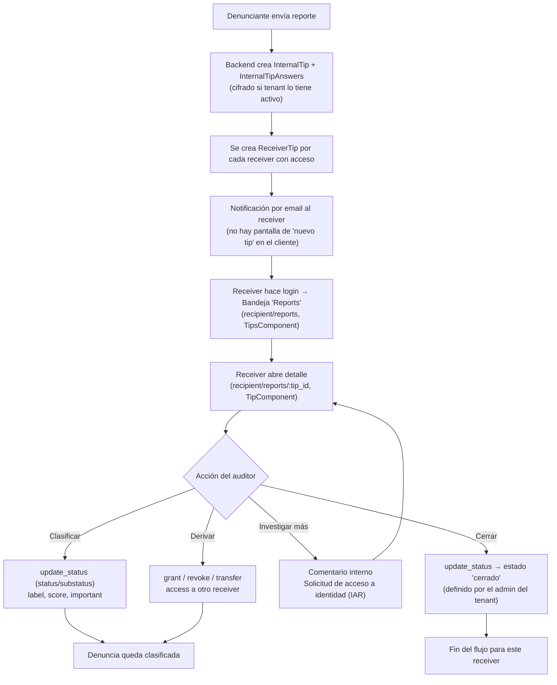
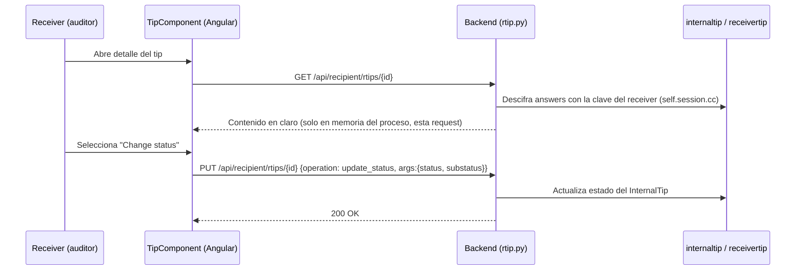

# Flujo de pantallas: de la denuncia al veredicto del auditor (receiver)

Ámbito: cliente Angular en `whistleblowing-software/client`, rol `receiver`
(el "auditor/revisor" en la terminología de GlobaLeaks).

## 1. Recepción (lado servidor, sin pantalla propia)

- No existe una pantalla de "nueva denuncia recibida" ni un badge de no-leídos
  en el sidebar del receiver (`client/app/src/pages/recipient/sidebar/sidebar.component.html`
  solo tiene enlaces fijos: Home, Reports, Settings).
- El aviso de que llegó una denuncia se resuelve **por email**, vía el motor de
  notificaciones del backend (configurado en `api/admin/notification`), no por
  una vista del cliente.
- Al enviarse la denuncia, el backend crea `_InternalTip` + `_InternalTipAnswers`
  (ver [04-modelo-datos-cifrado.md](04-modelo-datos-cifrado.md)) y una fila
  `_ReceiverTip` por cada receiver con acceso, con su propia copia envuelta de
  la clave del tip.

## 2. Bandeja / listado — "Reports"

- Ruta: `recipient/reports`
- Componente: `TipsComponent` (`client/app/src/pages/recipient/tips/tips.component.ts`)
- Resolver: `RTipsResolver` → `GET /api/recipient/rtips`
- Filtros disponibles (`processTips()` / `applyFilter()`):
  - **Estado** (`submissionStatusStr`, ver más abajo)
  - **Contexto/canal**
  - **Score** (Low/Medium/High/None)
  - Rango de fechas: fecha de la denuncia, última actualización, vencimiento
- Selección múltiple de denuncias para acciones en lote: **Grant access**,
  **Revoke access**, **Export**.

## 3. Vista de detalle

- Ruta: `recipient/reports/:tip_id`
- Componente: `TipComponent` (`client/app/src/pages/recipient/tip/tip.component.ts`)
- Fuente de datos: `GET /api/recipient/rtips/{id}` (`HttpService.receiverTip()`)
- Sub-componentes que arma la pantalla:
  - `TipInfoComponent` — datos generales, label editable
  - `TipQuestionnaireAnswersComponent` — el contenido real del cuestionario/denuncia
  - `WhistleBlowerIdentityReceiverComponent` — sección de identidad / solicitud de acceso a identidad (IAR)
  - `TipFilesReceiverComponent` — adjuntos
  - `TipReceiverListComponent` — qué otros receivers tienen acceso a este tip
  - `TipCommentsComponent` / `TipUploadWbFileComponent`, organizados en pestañas: **Everyone**, **Recipients only**, **Me only**

## 4. Acciones de clasificación / derivación / cierre

Todas en `tip.component.ts`, botones con id `tip-action-*`:

| Acción | Método cliente | Llamada API |
|---|---|---|
| Marcar como importante | `tipToggleStar()` | `PUT /api/recipient/rtips/{id}` op `set` `{key:"important"}` |
| Fijar recordatorio | `setReminder()` | op `set_reminder` |
| Activar/silenciar notificaciones | `tipNotify(bool)` | op `set` `{key:"enable_notifications"}` |
| Conceder acceso a otro receiver | `openGrantTipAccessModal()` | op `grant` |
| Revocar acceso | `openRevokeTipAccessModal()` | op `revoke` |
| Transferir | `openTipTransferModal()` | `PUT /api/recipient/rtips/{id}` `{operation:"transfer", args:{receiver}}` |
| Posponer vencimiento | `tipPostpone()` | op `postpone` |
| Redactar/enmascarar contenido | `toggleRedactMode()` | `POST/PUT /api/recipient/redactions` |
| **Cambiar estado (clasificación)** | `openModalChangeState()` → `updateSubmissionStatus()` | op `update_status` `{status, substatus}` |
| Reabrir | `openModalReopen()` → `updateSubmissionStatus()` | op `update_status` |
| Eliminar | `tipDelete()` | delete op |
| Exportar / descargar | `exportTip(tipId)` | `GET /api/recipient/rtips/{id}/export?token=...` |
| Agregar comentario/nota interna | `TipCommentsComponent` | `POST /api/recipient/rtips/{id}/comments` |
| Solicitar acceso a identidad | `fileIdentityAccessRequest()` | crea un IAR (requiere aprobación de `custodian`, ver [05](05-roles-permisos.md)) |

**Estados/etiquetas de clasificación**: no hay un enum fijo en el cliente. Los
estados (`submissionStatuses`) los define el admin del tenant (`public.submission_statuses`,
cargados en `AppDataService.submissionStatuses`), cada uno con `substatuses`
anidados. Independiente del estado existen también `tip.label` (texto libre),
`tip.important` (estrella) y `tip.score` (Low/Medium/High) como campos de
clasificación adicionales.

## Diagrama de flujo

## Secuencia de una decisión (cambio de estado)

