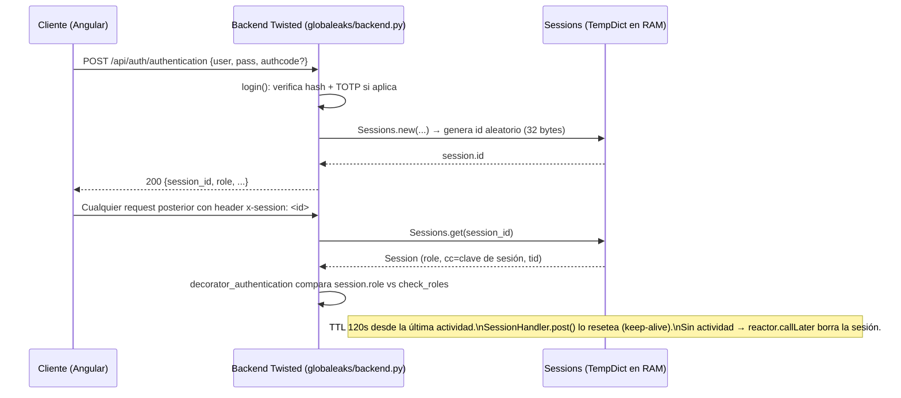

# Modelo de autenticación real

Ámbito: `whistleblowing-software/backend/globaleaks`.

## Resumen

**No es JWT.** Es una sesión opaca server-side, en memoria (RAM del proceso
Twisted), identificada por un ID aleatorio, transportada en un header HTTP
custom (`x-session`), **no en cookie**. Vida corta con renovación tipo
"sliding expiration" (keep-alive desde el cliente).

## 1. Handlers de login

`backend/globaleaks/handlers/auth/__init__.py`:

- `AuthenticationHandler` — `POST /api/auth/authentication` — login de usuarios internos (admin/receiver/custodian/analyst) → `login()`.
- `ReceiptAuthHandler` — `POST /api/auth/receiptauth` — login del denunciante por su código de recibo → `login_whistleblower()`.
- `TokenAuthHandler` — login por token pre-emitido de corta vida (`Sessions.get(...)` + `Sessions.regenerate`).
- `SessionHandler` — `POST` para renovar/mantener viva la sesión, `DELETE` para logout (`del Sessions[self.session.id]`).
- `TenantAuthSwitchHandler` / `OperatorAuthSwitchHandler` — emiten una nueva sesión al cambiar de tenant/operador.

## 2. Qué token se emite

Objeto `Session` (`backend/globaleaks/sessions.py`), ID de 32 bytes aleatorios en hex:

```python
'id': nacl_random(32).hex()
```

Guardado únicamente en `SessionsFactory`, un `TempDict` **en memoria del proceso**, no en la base de datos. El cliente reenvía el ID en cada request vía header:

```python
session_id = self.request.headers.get(b'x-session')
if session_id:
    session = Sessions.get(session_id.decode())
```
(`handlers/base.py`)

Existe además un header/paramétro separado `x-token` / `?token=` para objetos `Token` anti-automatización (`handlers/auth/token.py`, `utils/token.py`), usados por ejemplo antes de un envío o login para rate-limiting — no es el mismo mecanismo que la sesión.

## 3. Vida útil (TTL)

- `Settings.authentication_lifetime = 120` segundos (`backend/globaleaks/settings.py:40`), usado como timeout del `TempDict` de sesiones: `Sessions = SessionsFactory(timeout=Settings.authentication_lifetime)`.
- Expira vía `reactor.callLater(timeout, delete)` (Twisted) en `utils/tempdict.py`.
- Se mantiene viva por heartbeat del cliente: `SessionHandler.post()` llama `Sessions.reset_timeout(self.session)`, reseteando el `callLater`.
- **No hay sesiones "largas" vs "cortas" por rol** — admin, receiver y whistleblower usan el mismo `TempDict` de 120s y el mismo mecanismo de renovación; el rol solo afecta `Session.attrs['role']` y los checks de permiso.
- El acceso del denunciante a su propio tip (`login_whistleblower()`) también es una `Session` normal con `role='whistleblower'`, no un token de acceso de vida distinta.
- Tokens anti-replay de 2FA tienen su propio `TempDict` de 120s (`State.TwoFactorTokens`, `state.py:99`).

## 4. Dónde se valida en cada request

- `BaseHandler.get_session()` (`handlers/base.py`, ~línea 126) se ejecuta en el `__init__` de cada handler: lee `x-token`/`?token=` y `x-session`, llama `Sessions.get(session_id)`, y verifica `session.tid == self.request.tid`.
- El control de rol es un **decorador aplicado al registrar la ruta**: `decorate_method()` (`rest/decorators.py:159`) envuelve cada método del handler con `decorator_authentication(f, roles)`, que compara `self.session.role` contra `h.check_roles` y lanza `errors.NotAuthenticated` si no coincide. También aplica `decorator_require_session_or_token` y `decorator_rate_limit` en POST/PUT/DELETE.
- No hay decorador separado por handler individual más allá de este mecanismo — es un atributo de clase (`check_roles`) más el decorador genérico.

## 5. Segundo factor (TOTP)

- En `login()`: si `user.two_factor_secret` está seteado y falta `authcode` → `errors.TwoFactorAuthCodeRequired`; si no, `State.totp_verify(user.two_factor_secret, authcode)`.
- `State.totp_verify()` (`state.py:299`) valida el TOTP y bloquea reuso de código con el `TempDict` de 120s.
- También se usa para confirmación "step-up" en acciones sensibles vía header `x-confirmation` (`handlers/base.py`, ~línea 304-308, `db_confirmation_check()`).

## 6. Gateway / proxy

No hay nginx ni gateway separado delante del backend. `docker/docker-compose.yml` levanta un único contenedor `globaleaks` (build de `docker/Dockerfile`) que expone directamente los puertos 8080/8443 del propio proceso Twisted — el proceso Python termina TLS y hace toda la autenticación él mismo. `/home/veridy/globaleaks-config/globaleaks.conf` y `/home/veridy/globaleaks-external-config/globaleaks.conf` solo tienen configuración de red (`force_ssl`, `bind_address`, `public_hostname`), sin directivas de proxy o auth.

## Diagrama


