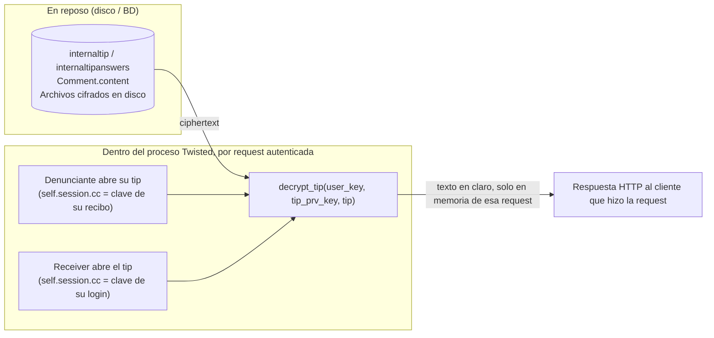

# Dónde vive el contenido de la denuncia y límite de cifrado

Ámbito: `backend/globaleaks/models/__init__.py` y `backend/globaleaks/utils/crypto.py`.

## 1. Modelos/tablas que guardan contenido

- `_InternalTip` (línea 612, tabla `internaltip`) — registro central del tip. No guarda el texto en sí, pero sí el material de claves por tip: `crypto_prv_key`, `crypto_pub_key`, `crypto_tip_pub_key`, `crypto_tip_prv_key` (blobs base64).
- `_InternalTipAnswers` (línea 653, tabla `internaltipanswers`) — `answers = Column(JSON, default=dict, nullable=False)`: el blob de respuestas del cuestionario, indexado por `(internaltip_id, questionnaire_hash)`.
- `_InternalTipData` (línea 669, tabla `internaltipdata`) — key/value genérico (`key`, `value` JSON), usado para campos extra como `whistleblower_identity`.
- `_Comment` (línea 230, tabla `comment`) — `content = Column(UnicodeText, nullable=False)`.
- `_InternalFile` (línea 592, tabla `internalfile`) — metadata de adjuntos: `name`, `content_type`, `size`, `reference_id`.
- `_ReceiverTip` (línea 755) / `_ReceiverFile` (línea 1023) — registros del lado receiver; `ReceiverTip.crypto_tip_prv_key` guarda la clave del tip envuelta para ese receiver en particular.

## 2. Formato de almacenamiento

Todo vive como texto/JSON en la base SQL, pero **no en claro** cuando el
cifrado está activo:

- `InternalTipAnswers.answers` es una columna JSON, pero su valor es un
  **string base64 de ciphertext**, no un objeto con las respuestas reales.
- `Comment.content`, `name`/`content_type` de archivos, `label` y los
  motivos de IAR son columnas `UnicodeText` con el mismo patrón: string
  base64 de ciphertext.
- El contenido binario de los archivos **no está en la base de datos** —
  solo la metadata; el archivo en sí vive en disco bajo `Settings.attachments_path`.

## 3. Cifrado en reposo

Motor de cripto: `_GCE` (Global Crypto Engine) en `utils/crypto.py`, sobre PyNaCl/libsodium:

- Asimétrico: `SealedBox` sobre Curve25519 (`asymmetric_encrypt`/`asymmetric_decrypt`).
- Simétrico: `SecretBox` XSalsa20-Poly1305 (`symmetric_encrypt`/`symmetric_decrypt`).
- Streaming de archivos: `_StreamingEncryptionObject` — SecretBox por chunks con clave aleatoria por archivo, sellada con la clave pública del tip.
- KDF: Argon2id para derivar claves desde contraseñas/recibos.

Es un **ajuste de tenant** (`encryption`, default `True`, `models/config_desc.py:57`), verificado al crear la denuncia en `handlers/whistleblower/submission.py: db_create_submission`:

```python
if crypto_is_available:
    crypto_tip_prv_key, itip.crypto_tip_pub_key = GCE.generate_keypair()
    itip.crypto_prv_key = Base64Encoder.encode(GCE.symmetric_encrypt(key, user_session.cc))
    itip.crypto_tip_prv_key = Base64Encoder.encode(GCE.asymmetric_encrypt(itip.crypto_pub_key, crypto_tip_prv_key))
    ...
    answers = Base64Encoder.encode(
        GCE.asymmetric_encrypt(itip.crypto_tip_pub_key, json.dumps(answers, cls=JSONEncoder).encode())
    ).decode()
```

Si el cifrado está desactivado a nivel tenant, el contenido puede quedar
como JSON plano real en `internaltipanswers.answers`. Cuando está activo,
cada tip tiene su propio par Curve25519; la clave privada del tip se vuelve a
envolver una vez por cada parte autorizada: la clave de sesión del
denunciante (`itip.crypto_tip_prv_key`), la clave pública de cada receiver
(`ReceiverTip.crypto_tip_prv_key`), y opcionalmente una clave de custodia/escrow
(`crypto_escrow_pub_key`, configurada en `handlers/admin/tenant.py`).

## 4. Dónde se descifra (el límite real)

El descifrado ocurre **solo dentro del proceso que atiende una request HTTP autenticada, en memoria, por request**:

- `handlers/whistleblower/submission.py: decrypt_tip(user_key, tip_prv_key, tip)` — rutina central única: desenvuelve la clave del tip con la clave del que llama (`GCE.asymmetric_decrypt(user_key, tip_prv_key)`), y descifra campo por campo (`answers`, `label`, `whistleblower_identity`, motivos de IAR, comentarios, metadata de archivos).
- Lado denunciante: `handlers/whistleblower/wbtip.py:197` — `decrypt_tip(self.session.cc, crypto_tip_prv_key, tip)`, usando la clave derivada de su recibo.
- Lado receiver: `handlers/recipient/rtip.py:1140/1159`, dentro de `GetRTip`, guardado tras `if State.tenants[tid].cache.encryption and crypto_tip_prv_key:` — se ejecuta cuando el receiver abre el tip en la UI, usando la clave derivada de su propio login (`self.session.cc`).
- Descifrado de archivos: `GCE.streaming_encryption_open('DECRYPT', tip_prv_key, filelocation)`, tanto en `wbtip.py` como en `rtip.py`, ejecutado en el proceso que sirve esa descarga puntual.
- Los emails de notificación (`db_notify_report_update`) **no descifran** — usan solo metadata/campos no sensibles, evitando que el contenido en claro quede en la cola de correo.

**Resumen del límite de cifrado**: ciphertext en disco/BD → se descifra de
forma transitoria dentro del proceso backend que atiende esa request
puntual de un usuario ya autenticado (denunciante o receiver concreto),
usando una clave que solo existe en la sesión de ese usuario
(`self.session.cc`). Nunca hay una copia global en claro persistida.

## 5. Adjuntos vs. respuestas de texto

Rutas y cifrado separados:

- Texto/comentarios/metadata: cifrado campo por campo con `GCE.asymmetric_encrypt`, guardado como string base64 en columnas de la BD.
- Bytes de archivo: subidos a un `GLSecureTemporaryFile`, entregados a disco por el job `Delivery` (`jobs/delivery.py`), que hace `write_encrypted_file(...)` (SecretBox por chunks, clave sellada con `crypto_tip_pub_key`) o `write_plaintext_file(...)` si el cifrado está desactivado.

**Asimetría a tener en cuenta**: el propio código documenta en
`models/__init__.py:1023-1027` que `_ReceiverFile` (archivos que un receiver
sube de vuelta al denunciante) **no se cifra ni se verifica su integridad**
de forma significativa — a diferencia de los `InternalFile` que sube el
denunciante.

## Diagrama del límite de cifrado


