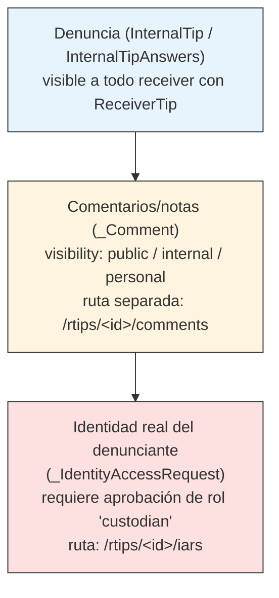

# Roles y permisos

Ámbito: `backend/globaleaks/models/enums.py`, `backend/globaleaks/handlers/base.py`, `backend/globaleaks/handlers/recipient/`.

## 1. Roles existentes

`models/enums.py`:

```python
class EnumUserRole(_Enum):
    admin = 0
    receiver = 1
    custodian = 2
    analyst = 3
```

El denunciante (`whistleblower`) **no es una cuenta `User`** — no aparece en
este enum. Se maneja como un `role` de sesión string (`handlers/base.py:157`:
`if session.role != 'whistleblower' ...`). El espacio de roles real en
runtime es: `admin`, `receiver`, `custodian`, `analyst`, `whistleblower`.

## 2. Cómo se distingue/enforza "receiver"

No hay tabla de ACL separada: cada clase handler define un atributo
`check_roles` (default `'admin'` en `BaseHandler`), comparado contra
`session.role` por el decorador `decorator_authentication` (`rest/decorators.py`).

Los handlers de revisión de tips (`backend/globaleaks/handlers/recipient/rtip.py`,
líneas 1119, 1151, 1216, 1227, 1294, 1306, 1356) y `recipient/export.py:201`,
`recipient/__init__.py:187,201` fijan `check_roles = 'receiver'`. Otros
valores usados en el código: `'admin'`, `'any'`, `'user'`.

## 3. ¿Ya existe separación entre "ver denuncia cruda" y "ver denuncia con anotaciones"?

**Sí, en tres niveles distintos:**

1. **Contenido crudo del denunciante** — `_InternalTip` / `_InternalTipAnswers` / `_InternalTipData` (`models/__init__.py:612` y siguientes): las respuestas originales del cuestionario. Accesible por cualquier receiver con un `_ReceiverTip` válido para ese tip.

2. **Anotaciones/notas — modelo separado con visibilidad propia** — `_Comment` (línea 230): campos `internaltip_id`, `author_id`, `content`, y un campo `visibility` con `EnumVisibility` (`public=0, internal=1, personal=2`). Se expone en una ruta distinta a la del cuerpo del tip: `GET/POST /api/recipient/rtips/<uuid>/comments`, separada de `GET/POST /api/recipient/rtips/<uuid>`. Es decir: el sistema ya distingue arquitectónicamente entre el contenido original y las notas agregadas después, y controla por separado quién ve qué nivel de visibilidad de esas notas (pública para el denunciante, interna entre receivers, o personal).

3. **Identidad del denunciante — el nivel más restringido** — `_IdentityAccessRequest` / `_IdentityAccessRequestCustodian` (líneas 554, 578): un receiver puede pedir revelar la identidad real del denunciante, pero **solo un `custodian` puede aprobarlo** (`reply`, `reply_user_id`, `crypto_tip_prv_key`). Ruta: `/api/recipient/rtips/<uuid>/iars`. Este es el ejemplo más fuerte de acceso por capas: un `receiver` puede ver el contenido pseudonimizado del tip pero no la identidad real sin una segunda aprobación de otro rol.

## Diagrama de capas de acceso



## Nota de cierre

La documentación de los 5 archivos (00 a 05, en esta misma carpeta
`docs-auditoria-denuncias/`) describe el sistema **tal como está hoy**,
verificado contra el código real. El hallazgo de seguridad de
[03-puntos-extension.md](03-puntos-extension.md) (script `etl_incremental.py`
+ clave GCP expuesta) es independiente de esta arquitectura de roles y la
elude por completo al operar a nivel de archivo de base de datos — debería
remediarse antes de planear cualquier ampliación del sistema.
