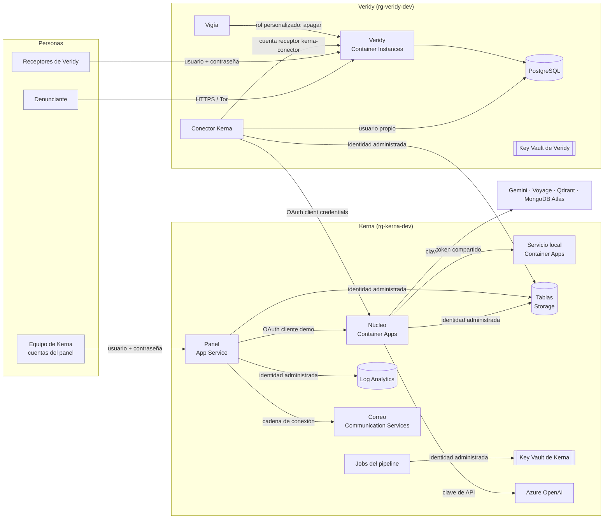

# Permisos e identidades de Kerna y Veridy

Cómo se identifica cada pieza del sistema, qué puede hacer y dónde viven sus secretos. Regla general: ningún secreto
está en el código ni en el repositorio. Los servicios de Azure se autentican con identidades administradas y roles de
alcance mínimo. Los secretos que no se pueden evitar (claves de proveedores externos, credenciales entre servicios)
viven en un Key Vault y llegan a cada servicio como referencia, nunca como texto.

## 1. Mapa

## 2. Identidades administradas y sus roles

Cada servicio que corre en Azure tiene una identidad administrada. Ninguna tiene permisos de propietario ni de
colaborador sobre el grupo de recursos: solo los roles de esta tabla, cada uno sobre el recurso concreto que necesita.

| Identidad | Tipo | La usa | Rol | Sobre qué | Para qué |
|---|---|---|---|---|---|
| `id-kerna-dev-nucleo` | asignada por el usuario | Núcleo | AcrPull | Registro de contenedores | Descargar su imagen |
| | | | Key Vault Secrets User | Key Vault de Kerna | Leer sus secretos (proveedores, JWT, clientes) |
| | | | Storage Table Data Contributor | Cuenta de tablas del núcleo | Solicitudes, sugerencias, uso, ajustes, clientes |
| Identidad del panel | del sistema (App Service) | Panel | Key Vault Secrets User | Key Vault de Kerna | Clave compartida, cliente demo y conexión de correo |
| | | | Log Analytics Reader | Área de trabajo de Log Analytics | Métricas del Resumen y del Informe |
| | | | Storage Table Data Reader | Tablas `evaluaciones`, `clientes`, `usodiario` | Calidad y Negocio |
| | | | Storage Table Data Contributor | Tablas `reintentosmanuales`, `ajustes`, `cuentas`, `cuentaseventos` y las de clientes | Pedir reintentos, guardar Ajustes, cuentas e historial, administrar clientes |
| | | | Monitoring Reader | Cuenta de Azure OpenAI | Tokens consumidos por despliegue |
| | | | Cost Management Reader | Suscripción | Costo real cobrado por Azure, por servicio |
| `id-kerna-dev-pipeline` | asignada por el usuario | Jobs del pipeline y de evaluación | AcrPull | Registro de contenedores | Descargar su imagen |
| | | | Key Vault Secrets User | Key Vault de Kerna | MongoDB, Qdrant, Gemini, Voyage y Atlas |
| | | | Storage Table Data Contributor | Tabla `evaluaciones` | Guardar mediciones |
| Identidad del servicio local | asignada por el usuario | Servicio local | AcrPull | Registro de contenedores | Descargar su imagen |
| | | | Key Vault Secrets User | Key Vault de Kerna | Token del servicio local |
| | | | Storage Blob Data Contributor | Contenedor del índice local | Guardar y leer el índice |
| Identidad de Veridy | asignada por el usuario | Veridy, conector y vigía | AcrPull | Registro de contenedores | Descargar las imágenes |
| | | | Key Vault Secrets User | Key Vault de Veridy | Contraseñas de base de datos y de las cuentas del conector |
| | | | Storage Table Data Contributor | Cuenta de tablas del núcleo de Kerna | Pedidos de reintento y estado compartido con el panel |
| | | | Rol personalizado «encendido» | Grupo de Veridy | Solo leer y **apagar** el grupo de contenedores y PostgreSQL |

La cuenta de administración (la persona que opera Azure) tiene además Key Vault Secrets Officer sobre los dos
Key Vaults, AcrPush sobre el registro y Storage Table Data Contributor sobre las tablas. Ningún servicio tiene esos
permisos.

## 3. Key Vaults y secretos

Los valores nunca se imprimen ni se escriben en disco: los scripts de `kerna/operaciones` los pasan por variables
de proceso. Los servicios los reciben como referencias de Key Vault (`@Microsoft.KeyVault(...)` en el panel y
secretos con `key_vault_secret_id` en Container Apps), que Azure resuelve con la identidad del servicio.

**Key Vault de Kerna** (`kv-kerna-dev-…`)

| Secreto | Lo lee | Para qué |
|---|---|---|
| `azure-openai-key`, `azure-openai-endpoint` | Núcleo | Modelos gpt-5-nano y gpt-5-mini |
| `gemini-api-key` | Núcleo, jobs | Modelo de respaldo |
| `voyage-api-key` | Núcleo, jobs | Embeddings de búsqueda |
| `qdrant-url`, `qdrant-api-key` | Núcleo, jobs | Base vectorial de la normativa |
| `mongodb-uri` | Jobs | Base documental de la normativa extraída |
| `atlas-public-key`, `atlas-private-key` | Jobs | Abrir y cerrar el acceso temporal a MongoDB Atlas |
| `kerna-jwt-secreto` | Núcleo | Firmar los tokens de acceso (JWT) |
| `kerna-clientes` | Núcleo | Clientes de la API: identificador y huella sha256 de su clave |
| `kerna-local-token` | Núcleo, jobs, servicio local | Token compartido con el servicio local |
| `demo-panel-client-id`, `demo-panel-client-secret` | Panel | Cliente propio del panel ante el núcleo (Demo de Denuncias) |
| `front-clave-panel` | Panel | Clave compartida de `/api/*` y firma de las cookies de sesión |
| `correo-acs-conexion` | Panel | Envío de correos por Communication Services |
| `veridy-db-admin-password`, `veridy-db-app-password` | Operación | Copia de respaldo de las credenciales de la base de Veridy |

**Key Vault de Veridy** (`kv-veridy-dev-…`)

| Secreto | Lo lee | Para qué |
|---|---|---|
| `veridy-db-admin-password`, `veridy-db-app-password` | Veridy | Usuarios administrador y de aplicación de PostgreSQL |
| `conector-pg-password` | Conector | Usuario propio del conector en PostgreSQL (su base de estado) |
| `veridy-kerna-conector-password` | Conector | Cuenta receptor `kerna-conector` en Veridy |
| `kerna-client-id`, `kerna-client-secret` | Conector | Credenciales del conector ante la API del núcleo |
| `veridy-kerna-equipo-*-password` | Operación | Cuentas de los equipos receptores (comité, auditoría, legal) |
| `veridy-kerna-e2e-password` | Pruebas | Cuenta receptor de las pruebas de extremo a extremo |

## 4. Comunicación entre servicios

| De → a | Cómo se autentica | Qué protege |
|---|---|---|
| Conector → Veridy (API) | Cuenta receptor `kerna-conector`: la contraseña viaja derivada con argon2id y cada inicio de sesión exige una prueba de trabajo, como cualquier receptor | El conector solo ve los casos compartidos con él, con el mismo cifrado por caso que un receptor humano |
| Conector → PostgreSQL | Usuario propio del conector, distinto del de Veridy | Su base de estado; no puede tocar las tablas de Veridy |
| Conector → Núcleo | OAuth 2.0 *client credentials*: `POST /oauth/token` con identificador y clave, que devuelve un JWT HS256 de 10 minutos | El núcleo compara la clave contra su huella sha256 en tiempo constante; nunca guarda la clave |
| Panel (Demo) → Núcleo | Igual que el conector, con su propio cliente `demo-panel` | El uso de la demo queda separado del de clientes reales |
| Núcleo → proveedores de IA | Clave de API por proveedor desde el Key Vault | El texto ya llega anonimizado dos veces: en el conector y en el núcleo |
| Núcleo y jobs → Servicio local | Token compartido `kerna-local-token` | El servicio local solo responde a quien lo presenta |
| Núcleo, panel y conector → Tablas | Identidad administrada con su rol (sección 2) | Sin claves de cuenta de almacenamiento |
| Panel → Log Analytics, métricas y costos | Identidad administrada | Solo lectura; solo cifras agregadas |
| Panel → Correo | Cadena de conexión de Communication Services desde el Key Vault | Envía desde `DoNotReply@<dominio>.azurecomm.net`; nunca registra el contenido |
| Vigía → Veridy y PostgreSQL | Identidad de Veridy con el rol personalizado «encendido» | Puede apagar tras 60 min sin uso, pero no borrar ni reconfigurar |
| Logic App → Panel | Sin credenciales | Visita `/salud` y `/` cada 15 min para que no se duerma; solo rutas públicas |

Clientes de la API del núcleo: los fijos (conector de Veridy, panel) están en el secreto `kerna-clientes`. Los
clientes agregados desde «Administrar clientes» se guardan en la tabla `clientes`, también como huella sha256. Al dar
de baja a un cliente, el núcleo deja de emitirle tokens en menos de 20 segundos.

## 5. Personas en el panel de Kerna

Cada persona entra con usuario y contraseña. Detalle técnico en `kerna/front/README.md`, sección «Accesos y roles».

**Roles**

| Sección | Dirección | Operación de IA | Comercial | Evaluación | Invitado |
|---|---|---|---|---|---|
| Resumen | ver | ver | ver | ver | — |
| Informe y descargas | ver | ver | ver | ver | — |
| Negocio | ver | — | ver | ver | — |
| Administrar clientes | editar | — | editar | ver | — |
| Ajustes y reintentos | editar | editar | — | ver | — |
| Cuentas e historial | editar | — | — | ver | — |
| Demo | usar | usar | usar | usar | usar |

- **Dirección:** dueña del sistema; única que crea, edita, restablece y elimina cuentas.
- **Operación de IA:** ajusta modelos, plazos y reintentos.
- **Comercial:** administra clientes, planes y márgenes.
- **Evaluación:** tutor y comité evaluador. Ve todo, incluido quién creó cada cuenta, los restablecimientos y los accesos, sin poder modificar nada.
- **Invitado:** solo la Demo.

El servidor aplica la tabla de permisos en cada ruta. El menú solo la refleja: una ruta sin permiso responde 403
aunque se escriba a mano.

**Contraseñas y sesiones**
- Se guardan con argon2id, con sal propia por cuenta, y nunca en claro ni en registros. Política: de 12 a 128 caracteres, distinta del usuario y del nombre.
- La cuenta nueva o restablecida recibe una contraseña temporal por correo y debe cambiarla al entrar.
- La sesión es una cookie firmada (HttpOnly, Secure, SameSite=Strict) de 8 horas. Se revisa contra la cuenta en cada petición: cambiar la clave o el rol, desactivar o eliminar la cuenta cierra sus sesiones abiertas.
- Bloqueos: 5 intentos fallidos bloquean la cuenta 15 minutos, y cada IP tiene un límite aparte de 5 fallos cada 5 minutos. La IP es la que agrega el proxy de Azure, no una que envíe el cliente. El mensaje de error es el mismo exista o no el usuario.
- Nadie puede eliminarse, desactivarse ni restablecerse a sí mismo, ni dejar el sistema sin una cuenta Dirección activa.

**Historial (`cuentaseventos`):** registra altas, ediciones, cambios de rol, restablecimientos, cambios de
contraseña, desactivaciones, eliminaciones, accesos, intentos fallidos y bloqueos, con fecha, quién lo hizo y a qué
cuenta. Nunca contiene contraseñas.

**Clave compartida:** el secreto `front-clave-panel` solo sirve para tres rutas de lectura de la API (`/api/metricas`,
`/api/proveedores`, `/api/negocio`), que usan los scripts de operación. No abre el panel ni modifica nada. También
firma las cookies: rotarla cierra todas las sesiones.

## 6. Personas en Veridy

Veridy mantiene su propio modelo de usuarios: administrador, receptores y denunciantes anónimos. Cada caso se cifra
con su propia clave y solo lo abren los receptores con acceso a ese caso. El conector es un receptor más
(`kerna-conector`): ve solo los casos compartidos con él y lee su texto únicamente en memoria. Lo que deriva de un caso
se guarda cifrado con la clave pública de ese caso. Las contraseñas de las cuentas de equipos y de pruebas están en el
Key Vault de Veridy.

## 7. Operación

- **Rotar un secreto:** cambiar el valor en su Key Vault y reiniciar el servicio que lo lee (`kerna/operaciones/reiniciar_nucleo.sh` para el núcleo, y reiniciar el App Service para el panel).
- **Rotar `front-clave-panel`:** cierra todas las sesiones del panel. Las cuentas y sus contraseñas no cambian.
- **Dar o quitar acceso al panel:** solo desde «Cuentas», con rol Dirección. Queda en el historial.
- **Revisar los roles de una identidad:** `az role assignment list --assignee <principal-id> --all -o table`.
- **Revisar quién lee un Key Vault:** `az role assignment list --scope <id del key vault> -o table`.
