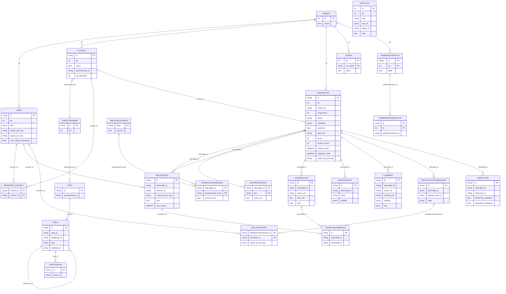

# Veridy: arquitectura actual e inventario de puntos de integración para Kerna

Informe técnico elaborado leyendo el código del repositorio `/home/veridy/whistleblowing-software`
(rama `feature/kerna-pipeline-azure`, HEAD `1c315822f`, árbol de trabajo con cambios sin commitear).
Las rutas son relativas a la raíz del repo salvo que se indique otra cosa. La notación `archivo:N` o
`archivo:N-M` indica líneas. Lo no comprobado directamente está marcado **[NO VERIFICADO]**.
Fuera de alcance: `kerna/` (lo analiza otra persona), el detalle criptográfico (otra persona),
`documentation/`, `client/dist`, `client/.angular`, `venv`, `docker/globaleaks.tar`.

---

## 0. Resumen ejecutivo

- Veridy es GlobaLeaks **5.0.85** (`backend/globaleaks/__init__.py:9`, `client/package.json:3`,
  `CHANGELOG:1`, `debian/changelog:1`, publicada el 12-oct-2025) con **esquema de BD 68**
  (`backend/globaleaks/__init__.py:12`). El último commit upstream incluido es `5cbb8951a` (3-nov-2025).
- Lo que Veridy cambió en código de aplicación está **sin commitear**: estadísticas del analista ampliadas,
  un endpoint nuevo de exportación CSV (`/api/analyst/export`), `avg` permitido en el autorizador SQLite,
  un `required` en selects largos del formulario del denunciante, la eliminación del "Powered by GlobaLeaks",
  traducciones al español y un Docker que compila cliente y backend desde el repo. Los 4 commits propios
  no tocan código de Veridy: añaden Kerna, la infraestructura y documentos de pendientes.
- Arquitectura: un proceso Python/Twisted (reactor único) con una API REST definida en una tabla
  (`rest/api.py:50-164`). Los permisos se declaran con `check_roles` y se aplican con decoradores
  (`rest/decorators.py:32-46,161-183`). El acceso a SQLite pasa por `@transact` sobre un ThreadPool(4,16)
  (`orm.py:142-201`, `state.py:95`). Las sesiones viven en memoria (`sessions.py:109`), los jobs son
  `LoopingCall` (`jobs/`) y el cliente es Angular 19 standalone con rutas por rol.
- Con el cifrado activado (`config_desc.py:57`, activo por defecto), el backend solo ve en claro el
  contenido de la denuncia en dos momentos: (1) durante el `POST /api/whistleblower/submission`, antes de
  cifrar (`handlers/whistleblower/submission.py:168-259`), y (2) durante una petición autenticada del
  receptor, con su clave de sesión (`handlers/recipient/rtip.py:1160`). Un job periódico **no** puede leer
  el contenido. Esto condiciona dónde puede engancharse Kerna (sección 10).

---

## 1. Versión de origen y stack

| Elemento | Valor | Referencia |
|---|---|---|
| Versión GlobaLeaks | 5.0.85 | `backend/globaleaks/__init__.py:9`; `client/package.json:3`; `CHANGELOG:1` ("Changes in version 5.0.85"); `debian/changelog:1-5` (fecha 12-oct-2025) |
| Versión de esquema BD | `DATABASE_VERSION = 68`, `FIRST_DATABASE_VERSION_SUPPORTED = 52` | `backend/globaleaks/__init__.py:12-13` |
| Último commit upstream | `5cbb8951a` "[ci] Fix e2e tests after implementation of dropdown buttons", 2025-11-03, G. Pellerano | `git log -1 5cbb8951a` |
| Python | `requires-python = ">=3.8"`. En Docker es el Python de Debian trixie (3.13) **[NO VERIFICADO en la imagen]** | `backend/pyproject.toml` |
| Twisted | 24.11.0 (pin pip). En Docker se usa el paquete Debian `python3-twisted` (versión de trixie **[NO VERIFICADO]**). En el host hay Twisted 24.3.0 en `/usr/lib/python3/dist-packages` | `backend/requirements/requirements.txt.trixie`; `debian/control:40` |
| SQLAlchemy | 2.0.40 (pin). En Docker, `python3-sqlalchemy` de Debian | `backend/requirements/requirements.txt.trixie`; `debian/control:39` |
| SQLite | Base de datos única `/var/globaleaks/globaleaks.db` con WAL, `synchronous=FULL`, FKs ON y un autorizador que restringe funciones SQL | `settings.py:90`; `orm.py:43-81` |
| Otras dependencias backend | cryptography 43, pynacl 1.5, pyOpenSSL 25, txtorcon 24.8, acme 4.0, fpdf2 2.8.3, pyotp, python-gnupg, h2, brotli | `backend/requirements/requirements.txt.trixie` |
| Tor | Dependencia del paquete Debian (onion services, salida anónima opcional) | `debian/control:42`; `state.py:116-120` |
| Angular | 19.2.15 (core, router, forms…), CLI 19.2.17, TypeScript 5.6.3 | `client/package.json:13,105` |
| Librerías del cliente | ngx-translate 17, ng-bootstrap 18, bootstrap 5.3.8, chart.js 4.5 + ng2-charts 8, ng-select 14.9, ngx-markdown 20, libsodium-wrappers-sumo 0.7.15, pdfjs-dist 5.4, flow.js | `client/package.json:9-63` |
| Build del cliente | Grunt (`grunt build` → `ng build --configuration=production`, más copia, webpack de workers, postcss y brotli) | `client/Gruntfile.js:243,872-874` |
| Pruebas e2e | Cypress 15.4 + axe-core | `client/package.json` |

---

## 2. Ajustes propios de Veridy

### 2.1 Commits propios (no upstream)

`git log --oneline -15`: los cuatro commits más recientes son de Veridy; del 5º hacia atrás todo es upstream.

| Commit | Autor y fecha | Contenido (`git show --stat`) | Interpretación |
|---|---|---|---|
| `3837d778e` | Stivaly Gomez, 2025-12-13 | `MANUAL.md` (+1 línea, prácticamente vacío) | Marcador de posición |
| `cf6084f46` | Stivaly, 2026-10-02 | Commit vacío ("chore: commit de prueba (verificación de push)") | Prueba de push |
| `deeaa8b62` | Stivaly, 2026-10-02 | 27 archivos, +2169: `infra/terraform/*` (Azure: ACR, Key Vault, Log Analytics, Container Apps jobs), `infra/scripts/subir_imagen.sh`, `kerna/pipeline_bcn/*` (extractor BCN/LeyChile, MongoDB, Dockerfile, tests), `pendientes/*` | Componente Kerna y su infraestructura. No toca `backend/` ni `client/` (no analizado aquí por alcance) |
| `1c315822f` | Stivaly, 2026-10-02 | `pendientes/kerna-pendientes.md` | Documentación de pendientes |

Notas de repositorio:
- Los remotos `origin` y `upstream` apuntan **los dos** a `git@github.com:Stivaly/whistleblowing-software.git`
  (`git remote -v`). No hay remoto hacia el GlobaLeaks oficial.
- `docker/globaleaks.tar` (180 MB) está **añadido al índice** (estado `A`) sin commitear (`git status`).

### 2.2 Cambios sin commitear (lo que de verdad es "Veridy" en la aplicación)

#### a) Backend – estadísticas del analista ampliadas (`backend/globaleaks/handlers/analyst/__init__.py`)
- `get_stats` (`:14-95`) añade a las métricas upstream:
  - `reports_last_30_days`: tips con `creation_date >= now-30d` (`:56-59`).
  - `reports_important`: tips con `important == True` (`:61-63`). `important` es la "estrella" que marca el receptor.
  - `reports_by_status`: diccionario `{status_id: n}`, con `GROUP BY status` (`:65-70`).
  - `average_access_count`: `AVG(InternalTip.access_count)` (`:72-74`). **Ojo:** `access_count` se
    incrementa cuando el **denunciante** entra con su recibo (`handlers/auth/__init__.py:65`), no cuando
    entra el receptor. La etiqueta del cliente, "Promedio de accesos por reporte", puede confundir.
  - `reports_with_files`: `COUNT(DISTINCT internalfile.internaltip_id)` (`:76-80`).
- Nueva función `get_reports_export` (`:98-158`) y nuevo handler `ExportReports` (`:171-220`,
  `check_roles = 'analyst'`, `async def get`) que devuelven un **CSV por reporte** con estas columnas:
  tenant, `progressive`, fechas de creación y actualización, etiqueta del estado (siempre en `'en'`, `:116`),
  `important`, `mobile`, `access_count`, anonimato ("Subscribed"/"Anonymous", sin distinguir "Subscribed later")
  y número de archivos. Fija las cabeceras `Content-Type: text/csv` y `Content-Disposition` (`:217-218`).
  - Las consultas de identidad (`:123-127`) y de conteo de archivos (`:130-133`) **no filtran por `tid`**.
    No se filtra nada al CSV, porque luego se cruzan con los reportes del tenant, pero recorren todos los tenants.
  - El `async def` funciona porque el `defer.maybeDeferred` de Twisted envuelve corrutinas
    (`api.py:516`; comprobado en el código de Twisted 24.3 del host, `defer.py`, en la rama `CoroutineType`).
  - **Cambio de alcance de privacidad:** en upstream el analista solo veía agregados (`get_stats`). Con el
    export ve metadatos **por reporte** (número progresivo, fechas, estado), algo que upstream no exponía a este rol.
- `backend/globaleaks/rest/api.py:105`: nueva ruta `('/api/analyst/export', analyst.ExportReports)`.
- `backend/globaleaks/orm.py:56`: se añade `'avg'` a la lista blanca de funciones del autorizador SQLite.
  **Es necesario:** sin él, el `func.avg` de `get_stats` se rechazaría (`SQLITE_DENY`, `orm.py:64-65`).

#### b) Cliente – página de estadísticas del analista
- `client/app/src/models/resolvers/statistics-resolver-model.ts`: añade los 5 campos nuevos.
- `client/app/src/pages/analyst/statistics/statistics.component.ts`: reorganiza en tres secciones
  (`operationalMetrics`, `effectivenessMetrics`, `trustMetrics`) y añade `exportReports()`, que llama a
  `utilsService.saveAs(..., 'api/analyst/export')` (descarga un blob con cabecera `X-Session`,
  `shared/services/utils.service.ts:431-441`).
  - Corrige un **bug upstream**: en el gráfico "Returning whistleblowers", "Yes" mostraba
    `reports_with_no_access` (los que **no** volvieron). Veridy usa `[with_access, no_access]`.
  - Elimina el gráfico "Tor", aunque el backend sigue calculando `reports_tor`.
  - `reports_by_status` y `trustMetrics.stats.*Percent` se calculan pero **no se pintan** en el HTML.
- `statistics.component.html`: tarjetas "Total", "Últimos 30 días", "Importantes", "Promedio de accesos",
  tortas por sección y botón "Export Reports".
- `pages/analyst/analyst.routes.ts:28`: `pageTitle "statistics"` pasa a `"Statistics"`, que sí coincide con la clave de traducción.

#### c) Cliente – otros ajustes
- `pages/whistleblower/form-field-input/form-field-input.component.html:47`: añade
  `[required]="entry.required_status"` al `ng-select` de los selectbox con 10 o más opciones. Corrige que una
  pregunta obligatoria con lista larga pudiera enviarse vacía.
- `shared/partials/footer/footer.component.html`: **elimina** `<div id="AttributionClause">Powered by GlobaLeaks</div>`.
  ⚠ Los términos adicionales de la licencia (AGPLv3 §7(b)) exigen conservar "Powered by GlobaLeaks" salvo
  consentimiento escrito, y la §7(c) exige un "Modified Material Notice" (`LICENSE:724-751` y `:753-790`).
  Es un riesgo legal (sección 11).

#### d) Traducciones
- `client/app/assets/data/i18n/es.json`: +17 claves (métricas, "Export Reports"…). **No tiene efecto en
  tiempo de ejecución:** el cliente carga los textos desde `l10n/<lang>` (`client/app/main.ts:81`), que
  sirve `L10NHandler` leyendo `data/l10n/<lang>.json` y fusionando `CustomTexts` (`handlers/l10n.py:13-49`).
  La carpeta `i18n/` es un residuo de la migración desde AngularJS (único commit en
  `git log -- client/app/assets/data/i18n/es.json`: `311bdab43`).
- `client/app/assets/data/l10n/es.json` (este sí es efectivo): reordenado entero. Antes tenía 628 claves y
  ahora 643: **+29** (las métricas nuevas y otras que parecen de otra versión de GlobaLeaks, como
  "Enable custodian user role" o "Postpone the expiration date") y **−14**, entre ellas `Mask`, `Reopen`,
  `Analyst`, `Tor`, `Unselect` y "You are operating on behalf of a whistleblower.". El cliente usa `Mask`, por
  ejemplo en `pages/recipient/tip/tip.component.ts:112`, así que esas cadenas **saldrán en inglés**. También
  hay traducciones que empeoran ("Specify" → "Specify", "Submit" → "Entregar"). Además, el
  `grunt fetchTranslations` (`client/Gruntfile.js:599-640`) regeneraría el archivo y **borraría** las claves de Veridy.

#### e) Despliegue (`docker/`, en el índice y con más cambios sin preparar)
- `docker/Dockerfile`: se quita `ADD https://deb.globaleaks.org/install.sh` y se usa el
  `docker/files/install.sh` versionado (`:18,22-28`). El contexto de build pasa a ser la raíz del repo
  (`COPY docker/files/*`). Se añade la compilación del cliente con Node de apt y Grunt, copiando el resultado
  a `/usr/share/globaleaks/client/` (`:32-39`), y se **sobrescribe el paquete Python** instalado por el .deb
  con el backend del repo (`COPY backend/globaleaks /usr/lib/python3/dist-packages/globaleaks`, `:41`).
- `docker/docker-compose.yml`: `build.context: ..` (`:3-5`), `container_name: veridy`, puertos ligados a la IP
  privada `10.147.17.68` (80→8080, 443→8443, 8080, 8443; `:11-15`) y volumen **externo** `docker_globaleaks` (`:27-29`).
- `docker/files/install.sh` (nuevo, copia del instalador oficial): instala el paquete `globaleaks` desde
  `deb.globaleaks.org` **sin fijar versión** salvo que se pase `-v` (`:143-159`).
- `docker/Readme.md`: comando `docker run` con `--name veridy` y puertos 80:8080 y 443:8443.

**Motivo aparente del conjunto:** adaptar GlobaLeaks a un despliegue propio ("Veridy"): marca blanca (sin
atribución), español, métricas de gestión y exportación para el analista, y un Docker reproducible con el
código modificado.

---

## 3. Backend

### 3.1 Arranque
1. `backend/bin/globaleaks`: parsea opciones (`-n`, `-z`, `-w`, `-m`, `-o`; `:47-74`), ejecuta
   `Settings.load_cmdline_options` (`:85`), reserva sockets **antes** de bajar privilegios
   (`State.bind_tcp_ports()`, `:88`; `state.py:153-178`), prepara el entorno (`state.py:105-110`: umask 077,
   rutas y directorios) y lanza `twistd` con `globaleaks/backend.py` (`:94-118`). `SIGUSR1` marca `State.reset_cache` (`:43-44,116`).
2. `backend/globaleaks/backend.py`: crea `Service` (`:44-51`) con `APIResourceWrapper`, envuelto en Brotli
   (`:49`), y un `Site`. `startService` programa `deferred_start` (`:105-106`), que a su vez:
   - `update_db()`: migra el esquema si hace falta o hace `perform_data_update` (`:76`; `db/__init__.py:81-112`).
   - Si no hay BD: `create_db()` + `initialize_db()`, que crea el tenant 1 (`:83-85`; `db/__init__.py:41-78`).
   - Escucha HTTP y HTTPS (con SNI) sobre los sockets reservados (`:87-94`).
   - `sync_refresh_tenant_cache()` y `sync_initialize_snimap()` (`:96-97`).
   - Arranca el threadpool del ORM (`:98`) y los jobs (`:99`, `start_jobs` `:53-60`, que también arranca el servicio Tor).

### 3.2 Reactor y acceso a la BD
- Hay un solo reactor Twisted para la red y para los timers de los jobs.
- `State.set_orm_tp(ThreadPool(4, 16))` (`state.py:95,112-114`) es el pool dedicado a la BD.
- Decorador `@transact` (`orm.py:142-201`): ejecuta la función en el pool con `deferToThreadPool`
  (`:158-163`), abre una sesión nueva por transacción, hace `commit` al terminar y **reintenta hasta 20 veces**
  si aparece `database is locked`, con backoff exponencial (`:172-197`). Devuelve un `Deferred`.
  `transact_sync` (`:204-206`) hace lo mismo pero de forma síncrona, solo para el arranque. `tw(f, ...)`
  (`:209-211`) ejecuta cualquier función `db_*` dentro de una transacción.
- Convención: las funciones `db_*(session, ...)` son síncronas y se componen dentro de una función `@transact`.
- Autorizador SQLite (`orm.py:49-65`): solo permite operaciones CRUD y las funciones
  `avg, count, length, lower, min, max, substr`. **Cualquier función SQL nueva hay que añadirla aquí.**

### 3.3 Estructura de paquetes (`backend/globaleaks/`)
| Paquete | Rol |
|---|---|
| `handlers/` | Handlers REST por rol: `admin/` (16 módulos), `analyst/`, `auth/`, `custodian/`, `recipient/` (`__init__`, `rtip.py`, `export.py`), `user/`, `whistleblower/` (`submission.py`, `wbtip.py`, `attachment.py`), más públicos (`public.py`, `l10n.py`, `staticfile.py`, `health.py`, `signup.py`, `wizard.py`…) |
| `rest/` | `api.py` (tabla de rutas y dispatcher), `decorators.py` (roles, cache, rate limit), `requests.py` (esquemas de validación), `errors.py`, `cache.py` |
| `models/` | `__init__.py` (ORM), `config.py` y `config_desc.py` (configuración clave-valor), `serializers.py`, `enums.py`, `properties.py` |
| `db/` | `__init__.py` (crear, actualizar, cache de tenants), `migration.py`, `migrations/update_53..update_68`, `appdata.py` |
| `jobs/` | Tareas periódicas |
| `utils/` | `crypto.py` (GCE), `templating.py` (correo), `mail.py`, `agent.py` (HTTP saliente), `pgp.py`, `tls.py`, `sni.py`, `ratelimit.py`, `tempdict.py`, `log.py`… |
| `services/` | `tor.py` |
| `state.py`, `settings.py`, `sessions.py`, `orm.py`, `backend.py` | Núcleo |
| `tests/` | 89 archivos `.py` (trial) |

### 3.4 Definición de la API
- `rest/api.py:50-164`: `api_spec` es una lista de tuplas `(prefijo, Handler[, regexp])`. Si no hay regexp se
  usa `re.escape(prefijo)` (`:167`). Hay bloques por rol: auth (`:57-65`), user (`:67-72`), receiver
  (`:74-85`), whistleblower (`:87-97`), custodian (`:99-101`), analyst (`:103-105`), admin (`:107-144`),
  signup, well-known y archivos especiales (`:146-163`). Lo que no encaja va a `StaticFileHandler` (`:170-171`).
- El enrutado usa un Trie por segmentos (`:174-218`). Al instanciar `APIResourceWrapper` se decoran una sola
  vez los métodos `get/put/post/delete` de cada handler (`:237-251`).
- Pasos de `render` (`:329-524`):
  1. Resuelve el **tenant** por hostname, `/t/<uuid>` o `/t/<subdominio>` (`:363-401`).
  2. Detecta el idioma (`:665-703`) y pone las cabeceras de seguridad, incluido CSP (`:526-663`).
  3. Aplica redirecciones a HTTPS y onion.
  4. Instancia `handler(State, request)` (`:456`), comprueba `root_tenant_only` (`:460-470`) y procesa uploads (`:472-480`).
  5. Ejecuta `maybeDeferred(f, handler, *groups)` (`:516`). Los `dict`/`list` se serializan a JSON y los `str` se escriben tal cual (`:504-514`).
  6. Mapa de códigos HTTP: POST→201, PUT→202 (`:223-230`). Errores: `GLException` → JSON `{error_message, error_code, arguments}`; cualquier otra excepción → 500 y correo al admin (`:284-327`).
- La CSP del punto de entrada tiene `connect-src 'self'` (`:552-567`). **El navegador no puede llamar a
  servicios externos: todo debe pasar por el backend.**

### 3.5 Permisos y decoradores (`rest/decorators.py`)
- `decorate_method` (`:161-183`) envuelve, en este orden (de dentro hacia fuera):
  - cache GET (`cache_resource`) o invalidación (`invalidate_cache`);
  - en `post/put/delete`: `decorator_require_session_or_token` (`:21-29`) y `decorator_rate_limit` (`:79-158`);
  - siempre: `decorator_authentication(f, roles)` (`:32-46`).
- Regla de `decorator_authentication`:
  - `'any'` deja pasar a cualquiera.
  - Si hay sesión del mismo tenant: `'user'` admite `{admin, analyst, custodian, receiver}` (`USERS_ROLES`, `:14`).
  - Si no, el `session.role` tiene que estar en `check_roles`.
  - En caso contrario lanza `NotAuthenticated`.
- `BaseHandler.check_roles = 'admin'` por defecto (`handlers/base.py:107`): un handler nuevo es solo-admin salvo que se declare otra cosa.
- Los permisos finos van **dentro** de las funciones `db_*`: por ejemplo, `db_access_rtip` exige un join
  User–ReceiverTip–InternalTip del mismo tenant (`handlers/recipient/rtip.py:557-573`), y hay flags en
  `User` (`can_redact_information`, `can_delete_submission`…, `models/__init__.py:962-972`) y en
  `session.permissions` (`can_edit_general_settings`, `handlers/auth/__init__.py:150-153`).

### 3.6 BaseHandler y sesiones
- `BaseHandler` (`handlers/base.py:106-439`): `get_session()` lee `X-Token` (token anti-bot con prueba de
  trabajo) o `X-Session` (`:126-158`). Ofrece validación declarativa con `validate_request` contra los
  descriptores de `rest/requests.py` (`:226-292`), subida por chunks con flow.js (`process_file_upload`,
  `:353-408`), `write_file*`, `check_confirmation` (contraseña o 2FA, `:302-308`) y avisa si un handler
  tarda más de 120 s (`:108,433-439`; solo registra en el log).
- Sesiones (`sessions.py`): `Session(tid, user_id, user_tid, role, cc, ek)` (`:10-29`). `cc` es la clave
  privada del usuario y `ek` la de escrow. Se guardan **en memoria** en un `TempDict` con timeout
  `authentication_lifetime=120` (`:109`; `settings.py:40`), indexadas por `sha256(id)` y con `cc`/`ek`
  cifrados con el id de sesión (`:45-56,81-87`). No hay persistencia: un reinicio cierra todas las sesiones
  y no se puede escalar horizontalmente.
- Al hacer login se descifra `user.crypto_prv_key` con una clave derivada de la contraseña y se guarda en la
  sesión (`handlers/auth/__init__.py:130-150`). El denunciante entra con su recibo
  (`handlers/auth/__init__.py:32-77`). Antes del envío, `initialize_submission_session` genera un par de
  claves efímero (`sessions.py:112-114`).

### 3.7 Multitenancy
- La tabla `tenant` (`models/__init__.py:915-927`) y casi todas las tablas llevan `tid`. La resolución está
  en `api.py:363-401`. `State.tenants[tid].cache` (un `ObjectDict`) se rellena desde `Config` y
  `EnabledLanguage` en `db_refresh_tenant_cache` (`db/__init__.py:164-276`).
- Los handlers deben filtrar siempre por `self.request.tid` o `self.session.tid`; el decorador ya exige
  `session.tid == request.tid` (`decorators.py:38`).
- `root_tenant_only` y `root_tenant_or_management_only` sirven para operaciones de plataforma (`api.py:460-470`).

### 3.8 Jobs periódicos (`jobs/`)
- Base: `Job(task.LoopingCall)` (`jobs/job.py:13-97`) con estadísticas de duración, y las subclases
  `LoopingJob`, `MinutelyJob`, `HourlyJob` y `DailyJob` (`:100-145`). El registro está en `jobs_list`
  (`jobs/__init__.py:15-29`) y se instancian en `backend.py:53-55`.
- Lista: `Anomalies`, `CacheReset`, `CertificateCheck`, `Cleaning` (diario: borra tips caducados con
  cascada, correos de más de 14 días, etc., `jobs/cleaning.py:20-60`), `Delivery` (cada 5 s: mueve los
  adjuntos temporales a `attachments/` cifrándolos con `crypto_tip_pub_key`, `jobs/delivery.py:17-134`),
  `ExitNodesRefresh`, `Notification` (cada 10 s), `PeriodicDaily`, `PeriodicHourly`, `PeriodicMinutely`,
  `PGPCheck`, `SessionManagement` y `UpdateCheck`.

### 3.9 Notificaciones y correo
- Es un patrón de **cola en BD**:
  1. Los eventos dejan flags `new=True` en `ReceiverTip`, `Comment` o `WhistleblowerFile`.
  2. `Notification.generate` (`jobs/notification.py:141-200`) los recorre, serializa el tip y genera filas en
     `Mail` con `Templating` (`:45-66`; `utils/templating.py:592` define los tipos soportados).
  3. `spool_emails` envía hasta 100 correos por ciclo con `State.sendmail` (`:232-266`; `state.py:199-219`) y borra los enviados.
- Los correos llevan solo metadatos y enlaces, no el contenido de la denuncia (las plantillas están en
  `config_desc` / appdata **[NO VERIFICADO al detalle]**).
- Envío directo: `State.format_and_send_mail` (`state.py:284-287`) y `db_schedule_email` (`transactions/`).

### 3.10 Estado global y configuración
- `State` (`state.py:65-103,361`) es un singleton con: settings, tenants y mapas host/uuid/subdominio→tid,
  pool ORM, jobs, Tor, `TokenList`, `TempKeys`, `TempUploadFiles`, `RateLimit` y el agente HTTP saliente
  (`get_agent`: pasa por Tor si `anonymize_outgoing_connections`, `state.py:116-120`).
- `Settings` (`settings.py:14-141`) se configura por línea de comandos, no por variables de entorno.
  Valores: `working_path=/var/globaleaks`, puertos remotos 8080/8443, puerto local 8083 (Tor), la ruta del
  cliente se busca en `/usr/share/globaleaks/client` o `client/build` (`:8-11,97-112`) y el modo devel `-z` (`:116-123`).
- Configuración por tenant (`models/config_desc.py`): `ConfigDescriptor` (`:32-128`) declara el tipo y el
  valor por defecto de cada variable. `ConfigFilters` (`:131+`) agrupa variables (`node`, `notification`,
  `admin_node`…). `ConfigFactory` (`models/config.py:36-77`) hace get/set/serialize. Las variables nuevas se
  insertan con `update_defaults` (`config.py:66-77,175-183`), que solo se ejecuta si cambia `__version__`
  (`db/migration.py:130-146`). `get_val` devuelve el valor por defecto si falta la fila, pero `set_val` **no
  hace nada** si la fila no existe (`config.py:52-61`).
- Textos localizados de configuración: `ConfigL10N` (`models/__init__.py:292-319`). Textos de UI personalizados por tenant: `CustomTexts` (`:382-397`).

---

## 4. Modelo de datos

### 4.1 Tablas principales (`backend/globaleaks/models/__init__.py`)
Todas heredan de `Model` (`:91-202`), que define `update(values)` según `unicode_keys`, `int_keys`,
`bool_keys`, `localized_keys`, `json_keys`… y `dict(language)`. Las clases ORM finales están en `:1049-1182`.
Las FKs son `deferrable, initially DEFERRED` y la mayoría con `ON DELETE CASCADE`.

| Tabla | Clase (línea) | Campos clave / notas |
|---|---|---|
| `tenant` | `_Tenant` (:915) | id autoincremental, `active` |
| `config` | `_Config` (:249) | PK (`tid`, `var_name`), `value` JSON |
| `user` | `_User` (:930) | `role` ∈ {admin, receiver, custodian, analyst} (`enums.py` `EnumUserRole`; CHECK `:1020`), claves `crypto_*`, flags `can_*`, `pgp_key_*`, `two_factor_secret`, `UNIQUE(tid, username)` |
| `context` | `_Context` (:322) | canal o categoría de denuncia: `name`/`description` localizados, `questionnaire_id`, `additional_questionnaire_id`, `tip_timetolive`, umbrales de score |
| `receiver_context` | `_ReceiverContext` (:718) | N:M contexto↔receptor |
| `questionnaire` | `_Questionnaire` (:703) | |
| `step` | `_Step` (:817) | `questionnaire_id`, `order`, `label` |
| `field` | `_Field` (:413) | `step_id` o `fieldgroup_id`, `type` (inputbox, textarea, selectbox…, `:15-27`), `template_id` (p. ej. `whistleblower_identity`) |
| `fieldattr`, `fieldoption`, `fieldoptiontriggerfield/step` | (:451, :485, :510, :523) | atributos, opciones y lógica condicional |
| `archivedschema` | `_ArchivedSchema` (:205) | `hash` → `schema` JSON del cuestionario congelado al enviar (**en claro**) |
| `internaltip` | `_InternalTip` (:612-650) | la denuncia: `tid`, `context_id`, `progressive` (UNIQUE por tid), `status`/`substatus`, `important`, `label`, `score`, `tor`, `mobile`, `access_count`, `expiration_date`, `reminder_date`, `receipt_hash`, `crypto_prv_key`, `crypto_pub_key`, `crypto_tip_pub_key`, `crypto_tip_prv_key`, `enable_whistleblower_identity`, `operator_id` |
| `internaltipanswers` | (:653) | PK (`internaltip_id`, `questionnaire_hash`), `answers` JSON (cifrado como cadena base64 si hay cifrado) |
| `internaltipdata` | (:669) | PK (`internaltip_id`, `key`), p. ej. `whistleblower_identity` (cifrado) |
| `receivertip` | `_ReceiverTip` (:755) | acceso de un receptor a un tip: `crypto_tip_prv_key` (clave del tip cifrada para el receptor), `new`, `last_access`, `last_notification`, `enable_notifications` |
| `internalfile` | (:592) | adjunto del denunciante (nombre, tipo y tamaño cifrados si hay cifrado; contenido en disco) |
| `whistleblowerfile` | (:737) | entrega de un internalfile a un receivertip |
| `receiverfile` | (:1023) | archivo subido por el receptor (`visibility`) |
| `comment` | `_Comment` (:230) | `internaltip_id`, `author_id`, `content` (cifrado), `visibility` ∈ {public, internal, personal}, `new` |
| `identityaccessrequest` | (:554) | solicitud del receptor para ver la identidad; `reply` (pending, authorized, denied) |
| `identityaccessrequest_custodian` | (:576) | custodio ↔ IAR, `crypto_tip_prv_key` |
| `redaction` | `_Redaction` (:780) | enmascarado/redacción por `reference_id` y `entry`: `temporary_redaction`, `permanent_redaction` |
| `submissionstatus` / `submissionsubstatus` | (:836, :859) | estados (`new`, `opened`, `closed` son de sistema; `handlers/admin/tenant.py:29`) y subestados por tenant |
| `auditlog` | `_AuditLog` (:214) | `tid`, `date`, `type`, `user_id`, `object_id`, `data` JSON. Se escribe con `db_log` (`orm.py:133-139`) |
| `mail` | `_Mail` (:683) | cola de correo |
| `customtexts`, `enabledlanguage`, `config_l10n`, `file`, `redirect`, `subscriber` | | soporte |

**WhistleblowerTip ya no existe:** se fusionó en `InternalTip` en la migración 60 (`db/migration.py:84`, entradas `-1` desde la versión 60).

### 4.2 Diagrama ER (campos clave)


(`_enc` indica que el campo va cifrado cuando el cifrado del tenant está activo. Ver `submission.py:242-278`, `rtip.py:891-894,1013-1015`.)

### 4.3 Migraciones (clave para añadir tablas)
- **No usa Alembic.** Hay un sistema propio de copia tabla a tabla entre dos ficheros SQLite (`db/migration.py:156-267`):
  1. Copia `globaleaks.db` a `tmp/old.db`.
  2. Para cada versión `v → v+1`, crea el esquema de `v+1` con `Bases[j+1]` (o con el `Base` actual en el último paso) en memoria o en `new.db`.
  3. Importa `globaleaks.db.migrations.update_<v+1>` y ejecuta `MigrationScript.prologue()`, luego `migrate_<Modelo>()` o la copia genérica (`db/migrations/update.py:57-82`), y por último `epilogue()`.
  4. Comprueba que el número de filas coincide (`:240-252`) y sustituye el fichero.
- `migration_mapping` (`db/migration.py:47-85`): por cada modelo, una lista con **una entrada por versión**
  desde la 52 hasta la 68 (17 posiciones). En cada posición: la clase válida desde esa versión, `0` (sin
  cambios) o `-1` (la tabla no existe). `MigrationBase.__init__` obliga a que la longitud sea
  `DATABASE_VERSION + 1 − FIRST_DATABASE_VERSION_SUPPORTED` (`db/migrations/update.py:27-31`).
- Las clases históricas se llaman `<Modelo>_v_<N>` (N = última versión en la que fueron válidas) y están en
  `db/migrations/update_<N+1>/__init__.py`. Ejemplo: `update_68` define `Subscriber_v_67` y un
  `migrate_Subscriber` específico (`db/migrations/update_68/__init__.py:7-50`).
- **Si la versión no cambia**, `update_db` solo ejecuta `perform_data_update` y no `create_all`
  (`db/__init__.py:94-101`). **Una tabla nueva no aparece en BDs existentes sin subir `DATABASE_VERSION`.**
- Las pruebas exigen fixtures por versión: `tests/db/empty/globaleaks-<DATABASE_VERSION>.db`
  (`tests/helpers.py:571-574`) y `tests/db/populated/globaleaks-<N>.db` para cada N entre 52 y la versión
  actual (`tests/test_migration.py:44-48`).
- La receta para añadir una tabla está en la sección 10.3.

---

## 5. Cliente Angular

- **Versión:** Angular 19.2.15, componentes **standalone**, bootstrap en `client/app/main.ts:59-109`. Usa
  `HashLocationStrategy` (`:88`), así que las URLs son `#/recipient/...`. Tres interceptores HTTP (`:84-86`).
  `localStorage` se redirige a `sessionStorage` (`:14-31`).
- **Estructura (`client/app/src/`):**
  - `pages/` por rol y flujo: `admin`, `analyst` (home, sidebar, statistics), `custodian`, `recipient`
    (home, tips, tip, settings, sidebar, whistleblower-identity-receiver), `whistleblower` (submission,
    form-field-*, etc.), `auth`, `signup`, `wizard`, `action`, `dashboard`, `app`.
  - `shared/`: `partials/` (tip-info, tip-questionnaire-answers, tip-comments, tip-files-receiver,
    tip-receiver-list, footer, header, preferences…), `guards/` (admin, analyst, custodian, receiver,
    pageguard), `resolvers/` (statistics, r-tips, preference, node…), `services/` (`http.service.ts`,
    `utils.service.ts`, `crypto.service.ts`, `tip-service.ts`…), `modals/`, `pipes/`, `directive/`.
  - `services/helper/` (authentication, submission, receiver-tip, wbtip, translation…) y `services/root/` (app-config, app-interceptor).
  - `models/` (admin, app, authentication, component-model, receiver, resolvers, whistleblower).
- **Routing por rol** (`client/app/src/app.routes.ts`): `recipient` con `ReceiverGuard` (`:61-67`),
  `custodian` (`:69-79`), `analyst` con `AnalystGuard` (`:81-88`), `admin` (`:90-97`) y la vista del tip
  `reports/:tip_id` → `TipComponent` con `SessionGuard` (`:118-127`). Las subrutas están en
  `pages/<rol>/<rol>.routes.ts`, por ejemplo `pages/recipient/recipient.routes.ts`. Los guards solo
  comprueban `session.role` en el cliente (`shared/guards/receiver.guard.ts:18-29`); la autorización real
  la hace el backend.
- **Consumo de la API:** centralizado en `shared/services/http.service.ts`, con métodos como
  `requestReportSubmission` (`:146-148`), `requestStatisticsResource` (`:320-322`), `receiverTip`
  (`:328-330`) y `tipOperation` (`:453+`). `appInterceptor` (`services/root/app-interceptor.service.ts:52+`)
  añade `X-Session` y `Accept-Language`. Para algunas URLs (`protectedUrls`, `:20-28`, y el signup o el
  recibo) obtiene un token `api/auth/token` y resuelve una prueba de trabajo antes de enviar `x-token`. Los
  datos de cada página se precargan con resolvers.
- **i18n:** ngx-translate con `provideTranslateHttpLoader({prefix:"l10n/"})` (`main.ts:81`). El backend
  sirve `data/l10n/<lang>.json` fusionado con `CustomTexts` del tenant (`handlers/l10n.py:23-49`). En el
  HTML se usan los pipes `translate` y `TranslatorPipe`. Las cadenas fuente se extraen a `.po` con Grunt
  (`Gruntfile.js:499-593`).

---

## 6. Roles y permisos

| Rol | Qué ve / hace | Aplicación en el backend |
|---|---|---|
| **whistleblower** | Crea una denuncia (`/api/whistleblower/submission`), sube adjuntos, vuelve con su recibo, ve su tip (respuestas, comentarios públicos, archivos públicos del receptor), comenta, añade identidad o cuestionario adicional | `check_roles = 'whistleblower'` (`handlers/whistleblower/submission.py:306`, `wbtip.py:172-307`). El `user_id` de su sesión es el `itip.id` (`submission.py:239`; `auth/__init__.py:72`). No está en `USERS_ROLES` (`decorators.py:14`) |
| **receiver** | Lista de tips asignados (`/api/recipient/rtips`), detalle descifrado con su clave, estados y subestados, etiqueta, estrella, recordatorios, prórroga, comentarios (public, internal, personal), archivos, redacción o máscara (según flags), dar, revocar o transferir acceso, export ZIP/PDF y solicitar identidad (IAR) | `check_roles = 'receiver'` (`handlers/recipient/__init__.py:187,201`; `rtip.py:1119-1356`; `export.py:201`). Comprobación de pertenencia en `db_access_rtip` (`rtip.py:557-573`). Flags `User.can_*` (`models/__init__.py:962-972`; p. ej. `rtip.py:1079-1088`) |
| **custodian** | Lista y resuelve las IAR (autoriza o deniega el acceso a la identidad) | `check_roles = 'custodian'` (`handlers/custodian/__init__.py:109,123`) |
| **analyst** | Upstream: solo estadísticas agregadas. **Veridy:** además, el CSV por reporte | `check_roles = 'analyst'` (`handlers/analyst/__init__.py:165,175`) |
| **admin** | Toda la configuración (nodo, red, usuarios, contextos, cuestionarios, estados, notificaciones, HTTPS, tenants, auditoría) | `check_roles = 'admin'` (35 handlers) o `'user'` con chequeo interno de `session.permissions['can_edit_general_settings']` (`auth/__init__.py:150-153`; p. ej. `admin/node.py:118`) |
| **any** | Endpoints públicos (`/api/public`, `l10n`, auth…) | `check_roles = 'any'` (22 handlers) |

Recuento de `check_roles` (grep en `handlers/`): admin 35, any 22, receiver 11, user 6, whistleblower 10, analyst 2, custodian 2.
Filtros adicionales por rol: listas de IPs permitidas y obligatoriedad de Tor por rol
(`connection_check`, `handlers/base.py:61-83`; config `ip_filter_<rol>` y `https_<rol>`, `config_desc.py:60-80,155-170`).

---

## 7. Flujos (diagramas de secuencia)

### 7a. Envío de denuncia

```mermaid
sequenceDiagram
    autonumber
    participant B as Navegador (Angular)
    participant API as APIResourceWrapper (rest/api.py)
    participant H as SubmissionInstance (submission.py)
    participant TP as ThreadPool ORM (@transact)
    participant DB as SQLite
    participant J as Jobs Delivery/Notification
    participant M as SMTP

    B->>API: POST api/auth/token (prueba de trabajo, app-interceptor.service.ts)
    B->>API: POST api/auth/receiptauth (sin recibo) → sesión whistleblower efímera (sessions.py:112)
    loop adjuntos
      B->>API: POST api/whistleblower/submission/attachment (flow.js)
      API->>H: SubmissionAttachment.post → session.files (attachment.py:61-63; TempUploadFiles)
    end
    B->>API: POST api/whistleblower/submission {context_id, receivers, answers (en claro), identity_provided, score, receipt}
    API->>API: tenant, idioma, CSP; decorators: auth(whistleblower) + rate limit (decorators.py:93-111)
    API->>H: post() → validate_request(SubmissionDesc) (submission.py:312; requests.py:118-125)
    H->>TP: create_submission(...) (submission.py:297-299)
    TP->>DB: db_create_submission (submission.py:158-294)
    Note over TP,DB: crea InternalTip (status='new', progressive), flush → itip.id (:197-237)<br/>genera claves del tip y cifra answers, identidad y metadatos de archivos (:242-267)<br/>InternalTipAnswers, InternalTipData, InternalFile (:262-278)<br/>ReceiverTip por receptor con la clave del tip cifrada (:280-286)<br/>AuditLog 'whistleblower_new_report' (:294)
    TP-->>H: commit OK
    H-->>B: 201
    J->>DB: Delivery (5 s): InternalFile.new → WhistleblowerFile + cifra el archivo en disco (delivery.py:17-134)
    J->>DB: Notification (10 s): ReceiverTip.new → filas Mail (notification.py:155-200)
    J->>M: spool_emails → State.sendmail (notification.py:258-266)
```

### 7b. El receptor abre y gestiona una denuncia

```mermaid
sequenceDiagram
    autonumber
    participant B as TipComponent (pages/recipient/tip)
    participant API as rest/api.py
    participant R as RTipInstance (rtip.py:1147)
    participant TP as @transact
    participant DB as SQLite

    B->>API: GET api/recipient/rtips/{id} (X-Session) (http.service.ts:328)
    API->>R: get(tip_id) (rtip.py:1154)
    R->>TP: get_rtip → db_get_rtip (rtip.py:639-666)
    TP->>DB: db_access_rtip (pertenencia), last_access, si status=='new' → 'opened' (db_update_submission_status), AuditLog 'access_report'
    TP-->>R: serialize_rtip + crypto_tip_prv_key del receptor
    R->>R: process_logs (serializers.py:457)
    R->>R: deferToThread(decrypt_tip, session.cc, ...) (rtip.py:1160; submission.py:37-82)
    R->>TP: redact_report (rtip.py:698-725)
    R-->>B: JSON en claro (respuestas, comentarios, identidad si aplica)
    B->>API: PUT api/recipient/rtips/{id} {operation:'update_status', args:{status, substatus}}
    API->>R: OperationHandler.put → update_tip_submission_status (operation.py:14-22; rtip.py:529-554)
    R->>DB: itip.status/substatus, AuditLog 'update_report_status', recálculo de la retención (rtip.py:219-257); notificación a los demás receptores
    B->>API: PUT ... {operation:'set', args:{key:'label'|'important', value}} → set_internaltip_variable (label se cifra) (rtip.py:877-894)
    B->>API: POST api/recipient/rtips/{id}/comments {content, visibility} → create_comment (cifra content; Comment.new=True) (rtip.py:992-1025)
    B->>API: PUT ... grant|revoke|transfer|postpone|set_reminder (rtip.py:1167-1203)
```
"Etiquetas": en GlobaLeaks 5.0.85 hay **una** etiqueta de texto libre por tip (`InternalTip.label`, cifrada),
más la estrella `important` y estados y subestados configurables. No existe un sistema de *tags* múltiples.

### 7c. El analista consulta estadísticas (con los cambios de Veridy)

```mermaid
sequenceDiagram
    autonumber
    participant B as StatisticsComponent (pages/analyst/statistics)
    participant RS as StatisticsResolver
    participant API as rest/api.py
    participant S as analyst.Statistics / ExportReports
    participant TP as @transact
    participant DB as SQLite

    B->>RS: navegación #/analyst/statistics (analyst.routes.ts:22-29)
    RS->>API: GET api/analyst/stats (statistics.resolver.ts; http.service.ts:320)
    API->>S: Statistics.get (check_roles analyst) (analyst/__init__.py:161-168)
    S->>TP: get_stats(tid) (analyst/__init__.py:14-95)
    TP->>DB: COUNT por tid, access_count==0, mobile, tor, identidad (internaltipdata), [Veridy] últimos 30 d, important, GROUP BY status, AVG(access_count) [requiere 'avg' en orm.py:56], COUNT DISTINCT internalfile
    S-->>B: JSON agregados
    B->>B: initializeCharts(): secciones operacional, efectividad y confianza (statistics.component.ts)
    B->>API: [Veridy] GET api/analyst/export (utilsService.saveAs con X-Session)
    API->>S: ExportReports.get (async) (analyst/__init__.py:171-220)
    S->>TP: get_reports_export(tid) (:98-158)
    S-->>B: text/csv por reporte (progressive, fechas, estado 'en', important, mobile, access_count, anonimato, nº archivos)
```

---

## 8. Despliegue

- **Imagen** (`docker/Dockerfile`):
  1. Base `debian:trixie-slim@sha256:f230…` (`:7`).
  2. Usuario `globaleaks` 1000:1000 (`:20`).
  3. `install.sh`: añade el repo APT de GlobaLeaks e instala el paquete `globaleaks`, que trae las
     dependencias Debian (python3-twisted, sqlalchemy, nacl, tor…), sin versión fijada
     (`docker/files/install.sh:143-159`).
  4. `COPY client` → `npm install -d` → `grunt build` → `client/build/*` a `/usr/share/globaleaks/client/` (`:32-39`).
  5. `COPY backend/globaleaks` sobre el paquete instalado (`:41`).
  6. `EXPOSE 8080 8443` (`:46`), `USER 1000:1000` (`:48`), `CMD python3 /usr/bin/globaleaks --working-path=/var/globaleaks/ -n` (`:50`).
- **Compose** (`docker/docker-compose.yml`): build desde la raíz del repo (`:3-5`), `restart: unless-stopped`,
  puertos en `10.147.17.68`: 80→8080, 443→8443, 8080, 8443 (`:11-15`), volumen externo
  `docker_globaleaks:/var/globaleaks` (`:17-18,27-29`, hay que crearlo antes) y healthcheck
  `curl -k https://localhost:8443/api/health` (`:20-25`).
- **Puertos internos:** el backend escucha en `::` 8080 (HTTP, redirige a HTTPS salvo onion/ACME,
  `api.py:256-279`) y 8443 (HTTPS con SNI), más 8083 local para Tor (`settings.py:22-24`;
  `api.py:356-357`: el 8083 se considera tráfico Tor).
- **Datos persistentes** (`/var/globaleaks`): `globaleaks.db`, `files/`, `attachments/`, `tmp/` y `log/`
  (`settings.py:84-95`). Hay además un ramdisk `/dev/shm/globaleaks` (`settings.py:36`).
- **Construcción del cliente fuera de Docker:** `cd client && npm install -d && ./node_modules/grunt/bin/grunt build`
  produce `client/build`, que el backend detecta automáticamente (`settings.py:8-11`; mismo flujo en
  `.github/workflows/scripts/run_tests.sh`). Para desarrollo hay un proxy `ng serve` → `https://127.0.0.1:8443` (`client/proxy.conf.json`).
- **Empaquetado oficial:** `debian/` (pybuild, `debian/rules`), `scripts/build.sh` **[NO VERIFICADO al detalle]**.
- **Fuera de alcance:** `infra/terraform` (Azure para Kerna) no despliega Veridy **[NO VERIFICADO; según el mensaje de `deeaa8b62`, "aún sin aplicar"]**.

---

## 9. Pruebas

- **Backend:** `twisted.trial`, 89 archivos en `backend/globaleaks/tests/`, con `handlers/<rol>/test_*.py`,
  `jobs/`, `models/`, `rest/`, `utils/`, `test_migration.py` y `test_orm.py`. La base es
  `tests/helpers.py` (`TestGL` `:553`, `TestGLWithPopulatedDB` `:780`, `TestHandler` `:956` con
  `self.request(..., role=...)` `:975`, `TestHandlerWithPopulatedDB` `:1146` y
  `perform_full_submission_actions` `:932`). Usa un reactor falso (`Clock`, `:560-563`) y BDs de fixture por versión.
  - Ejecución: `cd backend && python3 -m twisted.trial globaleaks.tests`, que es lo que hace CI con coverage (`.github/workflows/scripts/run_tests.sh:19`).
  - `tests/handlers/analyst/test_analyst.py` solo comprueba las claves upstream. **No hay pruebas de las
    métricas nuevas ni de `ExportReports`.**
- **Cliente e2e:** Cypress, de `client/cypress/e2e/01-test-init.cy.ts` a `22-test-recipient-actions.cy.ts`,
  con `baseUrl https://127.0.0.1:8443` (`client/cypress.config.ts:80`). Necesita el backend en modo devel
  (`bin/globaleaks -z -n`) y el cliente compilado con `grunt build_for_testing_and_instrument`. Se ejecuta con
  `npm test` (= `cypress run --browser=chromium`, `client/package.json` scripts). El analista solo aparece en
  capturas y en el primer login (`19-test-acquire-documentation-screenshots.cy.ts:85-90`,
  `08-test-users-first-login.cy.ts:78-84`).
- **CI** (`.github/workflows/`): `tests.yml` (push/PR → `run_tests.sh`: instala tor, venv y requirements
  de la distro, build de testing, trial, backend devel + Cypress, coverage a Codacy), `build.yml` (build del
  .deb y Docker por distro), `codeql.yml`, `scorecard.yml` y `publiccode-yml-validation.yml`. **[NO VERIFICADO]**
  si los workflows funcionan en el fork, porque dependen de secretos como `CODACY_PROJECT_TOKEN`.

---

## 10. Puntos de integración para Kerna (clasificación, normativa aplicable y borradores)

### 10.0 Restricciones de arquitectura que condicionan la integración
1. **Visibilidad del contenido:** con cifrado activo (`config_desc.py:57`, por defecto `True`;
   comprobación en `submission.py:161`), el texto de la denuncia (respuestas, identidad, comentarios,
   etiqueta, metadatos de archivos y archivos en disco) solo está en claro:
   - durante el `POST` de envío, en memoria, antes de `submission.py:259-260`;
   - durante peticiones del receptor que traen `X-Session` (y por tanto `session.cc`): `rtip.py:1160` y `export.py:152`;
   - en el `POST` de comentarios del denunciante o del receptor, antes de cifrar (`wbtip.py:87-89`; `rtip.py:1013-1015`).

   Un job periódico o un worker externo **no** puede descifrar sin una clave concedida expresamente (ver P2).
   El análisis de opciones criptográficas corresponde a la otra persona.
2. **Llamadas salientes:** no hay `requests` en las dependencias. Hay que usar `twisted.web.client.Agent`
   (`utils/agent.py:22-35`), o `deferToThread` con cuidado. Si `anonymize_outgoing_connections` está
   activo, `State.get_agent()` sale por Tor (`state.py:116-120`). **Nunca** hay que hacer una llamada HTTP
   dentro de una función `@transact`: bloquearía uno de los 4 a 16 hilos del ORM y mantendría abierta una
   transacción SQLite.
3. **Navegador:** la CSP `connect-src 'self'` (`api.py:555`) impide que el cliente llame a Kerna
   directamente. Todo debe pasar por un handler del backend.
4. **Tiempo:** un handler que tarde más de 120 s solo genera un log de error (`base.py:433-439`), pero
   bloquea la UI. Las operaciones largas conviene hacerlas asíncronas (job o encolado) con consulta del resultado.
5. **Multitenancy:** cada artefacto de Kerna debe llevar `tid` o colgar de `internaltip_id`. Con FK
   `ON DELETE CASCADE` hacia `internaltip`, la limpieza por caducidad (`jobs/cleaning.py:23-37`) lo borra automáticamente.

### 10.1 Inventario de puntos de enganche

| # | Punto | Archivo:línea / función | Datos disponibles allí | Uso sugerido para Kerna |
|---|---|---|---|---|
| P1 | **Tras crear el InternalTip** (dentro de la transacción) | `handlers/whistleblower/submission.py:236-237` (flush → `itip.id`) hasta `:259` (cifrado de `answers`), en `db_create_submission` (`:158-294`) | **En claro:** `request['answers']` (dict `{field_id: [...]}`), `steps` del cuestionario (`:169`), `context` (nombre/descr.), `receivers`, `score`, `tor`/`mobile` y la identidad (`answers[whistleblower_identity.id]`, `:249-255`). Aún dentro de la transacción y en un hilo del ORM | **Solo** encolar: insertar una fila `kerna_job(internaltip_id, status='pending')`. No llamar a la IA aquí. Si hay que persistir contenido para un proceso asíncrono, se rompe el modelo E2E salvo que se cifre para Kerna (decisión criptográfica, ver P2) |
| P1-bis | **Tras el commit del envío** (fuera de la transacción) | `SubmissionInstance.post` (`submission.py:308-318`): encadenar un callback al `Deferred` de `create_submission` | **En claro en memoria:** el `request` validado (`:312`) y `self.session.user_id == itip.id` (`:239`). La transacción ya está confirmada | Lanzar en segundo plano (sin bloquear la respuesta 201) `kerna_client.classify(itip_id, answers, steps)` con `Agent`, sin persistir el texto. El resultado (categoría, normas, borrador) se guarda después con otro `@transact` |
| P2 | **Concesión de clave a Kerna como pseudo-destinatario** | Bucle `for user in receivers` (`submission.py:280-286`) y `db_create_receivertip` (`:146-155`). Modelo análogo: `ReceiverTip.crypto_tip_prv_key` y `IdentityAccessRequestCustodian.crypto_tip_prv_key` | Clave privada del tip en claro en memoria (`crypto_tip_prv_key`, `:243`) | Cifrar la clave del tip para una clave pública de Kerna y guardarla en una tabla propia, de modo que un worker pueda descifrar de forma asíncrona. **Implica un cambio del modelo de confianza:** lo evalúa la persona de cifrado |
| P3 | **Vista del tip del receptor** | `RTipInstance.get` (`handlers/recipient/rtip.py:1153-1164`): después de `decrypt_tip` (`:1160`) y de `redact_report` (`:1162`) | **En claro y con redacciones aplicadas:** `tip['questionnaires'][*]['steps'/'answers']`, `comments`, `data.whistleblower_identity` (si procede), `label`, `status`, `context_id`, archivos (metadatos). La sesión del receptor está presente | No modificar el GET; lo recomendable es un **handler nuevo** (P4) que reutilice `get_rtip` + `decrypt_tip` + `redact_report(enforce=True?)`, como hace `export.py:146-152`. Así Kerna recibe solo lo que el receptor puede ver |
| P4 | **Handler nuevo para el receptor** | Nuevo `handlers/recipient/kerna.py` (o dentro de `rtip.py`), ruta en el bloque receiver de `rest/api.py:74-85`, p. ej. `('/api/recipient/rtips', recipient.kerna.KernaAnalysis, r'/api/recipient/rtips/' + uuid_regexp + r'/kerna')` | Igual que P3 (plaintext bajo demanda) más los resultados persistidos | `POST`: solicitar análisis (con el contenido descifrado en la propia petición). `GET`: leer el último resultado (clasificación, normativa, borrador). `check_roles='receiver'` + `db_access_rtip` |
| P5 | **Job periódico** | Nueva clase `LoopingJob` en `jobs/kerna.py` y registro en `jobs/__init__.py:1-29` (lista `jobs_list`) | **Solo metadatos en claro**: `InternalTip` (fechas, estado, contexto, score, flags), `Context`, `ArchivedSchema` (preguntas) y las filas de las tablas de Kerna. No hay contenido, salvo con P2 | Procesar la cola `kerna_job`: enviar cargas cifradas para Kerna, consultar resultados asíncronos, reintentos y caducidad. Patrón calcado de `Notification`/`Delivery` (`jobs/notification.py:251-272`, `jobs/delivery.py:114-134`) |
| P6 | **Cambio de estado** | `db_update_submission_status` (`rtip.py:219-257`), llamado desde `update_tip_submission_status` (`:529-554`) y `db_get_rtip` (`:660-661`) | `itip` (metadatos), `status_id`, `substatus_id`, `user_id` | Disparar una reevaluación o registrar en la auditoría la decisión humana frente a la sugerencia de la IA (`db_log`, `orm.py:133-139`) |
| P7 | **Comentarios** | Receptor: `create_comment` (`rtip.py:992-1025`). Denunciante: `wbtip.create_comment` (`wbtip.py:79-100`) | `content` en claro antes de cifrar | Recomendado: el **borrador generado** se muestra al receptor, que lo edita y lo envía por el endpoint existente `POST /api/recipient/rtips/{id}/comments` (`api.py:78`). Así se mantiene la revisión humana sin una ruta nueva de escritura |
| P8 | **Nueva información del denunciante** | `update_identity_information` (`wbtip.py:104-121`), `store_additional_questionnaire_answers` (`wbtip.py:124-142`), `db_notify_recipients_of_tip_update` (`wbtip.py:56`) | Respuestas o identidad en claro antes de cifrar | Marcar el análisis de Kerna como desactualizado (flag en la tabla de Kerna) |
| P9 | **Estadísticas del analista** | `get_stats` (`handlers/analyst/__init__.py:14-95`), modelo `statistics-resolver-model.ts` y `statistics.component.ts/html` | Solo agregados | Añadir conteos por categoría de Kerna o normativa. ⚠ La categoría de una denuncia puede ser sensible: valorar si se guarda cifrada (entonces no es agregable en el servidor) o en claro |
| P10 | **Configuración de admin** | `ConfigDescriptor` y `ConfigFilters` (`models/config_desc.py:32-128,131+`); handler `admin/node.py` (`check_roles='user'`, `:118`); cliente `pages/admin/settings` | Config en claro en SQLite | Variables `kerna_enabled`, `kerna_url`, etc. **No** guardar el secreto de la API en `config` (tabla en claro): mejor un archivo 0600 en `/var/globaleaks` o una variable de entorno leída al arrancar. Recordar que `update_defaults` solo se ejecuta si cambia `__version__` (`db/migration.py:130-146`) |
| P11 | **Registro de rutas** | `rest/api.py:50-164` (+ import del módulo en `api.py:19-38` o en el `__init__` del paquete, como `recipient/__init__.py:16`) | — | Ver el patrón en 10.2 |
| P12 | **Cliente: página del tip del receptor** | `pages/recipient/tip/tip.component.html:143-158` (después de `src-tip-questionnaire-answers` y `src-tip-files-receiver`) o como **pestaña** nueva en `tabs`/`ngbNav` (`tip.component.html:159-169`; `tip.component.ts:103,146`, donde se inicializa `tabs`) | `RTipService.tip` (ya descifrado por el backend) | Componente standalone `src-tip-kerna` (patrón en 10.4) que llama a `/api/recipient/rtips/{id}/kerna` y ofrece "Usar como borrador" → rellena `src-tip-comments` |
| P13 | **Cliente: estadísticas del analista** | `pages/analyst/statistics/statistics.component.*`, `models/resolvers/statistics-resolver-model.ts`, `shared/resolvers/statistics.resolver.ts` | Agregados | Nueva sección "Clasificación IA" |
| P14 | **Notificación al receptor** | `utils/templating.py:592` (`supported_template_types`), plantillas en `config_desc` (`:422-427`), generación en `jobs/notification.py:141-200` | Metadatos | Opcional: aviso "análisis disponible", sin contenido |
| P15 | **Auditoría** | `db_log` (`orm.py:133-139`); visible en `/api/admin/auditlog` (`api.py:126-130`) | — | Registrar cada envío a Kerna, la versión del modelo y si el receptor aceptó o descartó, para trazabilidad |

### 10.2 Patrón: handler nuevo + ruta + permiso
```python
# backend/globaleaks/handlers/recipient/kerna.py  (archivo nuevo)
from twisted.internet.defer import inlineCallbacks, returnValue
from twisted.internet.threads import deferToThread
from globaleaks import models
from globaleaks.handlers.base import BaseHandler
from globaleaks.handlers.recipient.rtip import get_rtip, redact_report, db_access_rtip
from globaleaks.handlers.whistleblower.submission import decrypt_tip
from globaleaks.orm import transact
from globaleaks.state import State

@transact
def get_kerna_result(session, tid, user_id, itip_id):
    db_access_rtip(session, tid, user_id, itip_id)          # control de pertenencia (rtip.py:557)
    return [r.dict() for r in session.query(models.KernaAnalysis)
                                   .filter(models.KernaAnalysis.internaltip_id == itip_id)]

class KernaAnalysisHandler(BaseHandler):
    check_roles = 'receiver'                                  # decorators.py:32-46

    def get(self, itip_id):
        return get_kerna_result(self.request.tid, self.session.user_id, itip_id)

    @inlineCallbacks
    def post(self, itip_id):
        tip, key = yield get_rtip(self.request.tid, self.session.user_id, itip_id, self.request.language)
        if State.tenants[self.request.tid].cache.encryption and key:
            tip = yield deferToThread(decrypt_tip, self.session.cc, key, tip)
        tip = yield redact_report(self.session.user_id, tip, True)
        # llamada saliente FUERA de @transact, con Agent (utils/agent.py) → guardar el resultado con otro @transact
        ...
```
Registro en `rest/api.py` (bloque receiver, `:74-85`):
```python
('/api/recipient/rtips', recipient.kerna.KernaAnalysisHandler, r'/api/recipient/rtips/' + uuid_regexp + r'/kerna'),
```
Añadir `import globaleaks.handlers.recipient.kerna` en `handlers/recipient/__init__.py` (como `:16`).
Validar la entrada con un descriptor nuevo en `rest/requests.py` (patrón `CommentDesc`, `:169-172`). Una
prueba de ejemplo sería `tests/handlers/recipient/test_kerna.py` con `helpers.TestHandlerWithPopulatedDB`
y `self.request(user_id=..., role='receiver')` (ver `tests/handlers/analyst/test_analyst.py`).

### 10.3 Patrón: tabla nueva con migración (recomendado frente a añadir columnas a `internaltip`)
1. `models/__init__.py`: añadir la clase y su clase ORM.
   ```python
   class _KernaAnalysis(Model):
       __tablename__ = 'kerna_analysis'
       id = Column(UnicodeText(36), primary_key=True, default=uuid4)
       internaltip_id = Column(UnicodeText(36), nullable=False, index=True)
       creation_date = Column(DateTime, default=datetime_now, nullable=False)
       status = Column(UnicodeText(16), default='pending', nullable=False)
       result = Column(JSON, default=dict, nullable=False)     # ¿cifrado? → decisión de la persona de cifrado
       @declared_attr
       def __table_args__(self):
           return ForeignKeyConstraint(['internaltip_id'], ['internaltip.id'], ondelete='CASCADE',
                                       deferrable=True, initially='DEFERRED'),
   ```
   Y al final: `class KernaAnalysis(_KernaAnalysis, Base): pass` (patrón de `:1049-1182`).
2. `backend/globaleaks/__init__.py:12`: `DATABASE_VERSION = 69`.
3. `db/migration.py:47-85`: **añadir un `0` al final de todas las listas existentes** (18 posiciones) y una
   entrada nueva `('KernaAnalysis', [-1]*17 + [models._KernaAnalysis])`, porque `update.py:27-31` valida las longitudes.
4. Crear `db/migrations/update_69/__init__.py` con `class MigrationScript(MigrationBase): pass` (la copia
   genérica basta si no se transforman datos).
5. Fixtures de prueba: `tests/db/empty/globaleaks-69.db` y `tests/db/populated/globaleaks-69.db`
   (`helpers.py:571-574`; `test_migration.py:47-48`). Se pueden generar ejecutando la migración sobre los de la versión 68 **[NO VERIFICADO el procedimiento upstream]**.
6. Si se usa alguna función SQL nueva, añadirla al autorizador (`orm.py:56-62`).
7. Para **modificar** una tabla existente (p. ej. una columna nueva en `InternalTip`): congelar la clase
   actual como `InternalTip_v_68` en `update_69`, y en el mapping cambiar la posición 15 (versión 67) por
   `InternalTip_v_68` y poner `models._InternalTip` en la posición 17 (versión 69) (patrón de
   `migration.py:65` y `update_68`). Es más frágil: se desaconseja para Kerna.

**Alternativa sin migración:** guardar los resultados en el almacén de Kerna (fuera de SQLite) referenciando
`internaltip_id` y `tid`. Así se evitan las migraciones, pero se pierde el borrado en cascada (habría que
replicar `Cleaning` con un endpoint de purga) y los datos salen del perímetro de Veridy.

### 10.4 Patrón: componente Angular nuevo
1. Crear `client/app/src/shared/partials/tip-kerna/tip-kerna.component.ts` con `standalone: true`,
   `imports: [TranslateModule, TranslatorPipe, NgClass…]`, `@Input() tipService: ReceiverTipService` e
   `inject(HttpService)`. Patrón de los partials como `tip-info`.
2. Añadir en `shared/services/http.service.ts` los métodos `requestKernaAnalysis(id)` (POST) y
   `getKernaAnalysis(id)` (GET) contra `api/recipient/rtips/${id}/kerna`. El interceptor añade `X-Session` solo.
3. Crear el modelo de respuesta en `models/receiver/kerna-analysis.ts`.
4. En `pages/recipient/tip/tip.component.ts` (array `imports`, `:48-73`) y en `tip.component.html`
   (`:143-158`, o como pestaña en `tabs`), insertar `<src-tip-kerna [tipService]="RTipService">`.
5. Para "Usar como borrador", reutilizar `src-tip-comments` (`shared/partials/tip-comments`): rellenar su
   textarea o emitir un evento, de modo que el envío siga por `POST .../comments`.
6. Textos: añadir las claves a `client/app/assets/data/l10n/es.json` (no a `i18n/`). Para que sobrevivan a
   `grunt updateTranslations` habría que incorporarlas al flujo `.po` (`Gruntfile.js:499-593`) o gestionarlas
   como `CustomTexts` por tenant (`handlers/l10n.py:41-46`).
7. Para el analista: extender `statisticsResolverModel` y `statistics.component.*`. Para el admin: una pestaña
   en `pages/admin/settings` **[NO VERIFICADO: estructura interna de tabs de settings]**.

### 10.5 Qué datos están en claro y cuáles cifrados (resumen arquitectónico)
| Dato | En BD (cifrado activo) | Dónde está en claro en el backend |
|---|---|---|
| Respuestas del cuestionario | Cifrado (`internaltipanswers.answers`, `submission.py:259-260`) | Envío (`submission.py:168-259`) y GET del receptor (`rtip.py:1160`) |
| Identidad del denunciante | Cifrado (`internaltipdata`, `submission.py:249-257`) | Envío; GET del receptor si se ha concedido acceso (IAR) **[NO VERIFICADO: lógica exacta de visibilidad]** |
| Comentarios | Cifrado (`rtip.py:1013-1015`; `wbtip.py:87-89`) | POST de comentarios; GET del receptor |
| Etiqueta (`label`) | Cifrado (`rtip.py:891-892`) | PUT `set` y GET |
| Nombre, tipo y tamaño de adjuntos | Cifrado (`submission.py:264-267`) | GET del receptor |
| Contenido de adjuntos | Cifrado en disco (`delivery.py:100-111`) | Descarga del receptor (`rtip.py:1260+`) |
| Esquema del cuestionario (preguntas) | **En claro** (`archivedschema`) | Siempre |
| Contexto (nombre y descripción) | **En claro** | Siempre |
| Estado, subestado, fechas, `important`, `score`, `tor`, `mobile`, `progressive`, `access_count` | **En claro** | Siempre (jobs incluidos) |

---

## 11. Limitaciones y deuda técnica observada

**Propias de Veridy**
1. **El código de Veridy está sin commitear** (`git status`: 11 archivos M y docker en el índice) en una rama
   cuyo uso declarado es Kerna. Además hay un binario de 180 MB en el índice (`docker/globaleaks.tar`).
2. **Atribución eliminada** (`footer.component.html`): incumple AGPLv3 §7(b) (conservar "Powered by
   GlobaLeaks" salvo consentimiento escrito, `LICENSE:724-751`) y no hay "Modified Material Notice" (§7(c),
   `LICENSE:753-790`). Como la base 5.0.85 es del 12-oct-2025, la cláusula de "más de 6 meses sin
   actualizar" podría aplicar **[NO VERIFICADO: depende de releases oficiales posteriores]**.
3. **Traducciones:** las ediciones en `i18n/es.json` no tienen efecto. El `l10n/es.json` perdió claves en
   uso (p. ej. `Mask`) y sufrió regresiones de traducción. Un `grunt updateTranslations` borraría las claves de Veridy.
4. **Export del analista:** amplía lo que ve el rol (metadatos por reporte frente a solo agregados upstream).
   La etiqueta de estado sale siempre en inglés, no distingue "Subscribed later", tiene consultas sin filtro
   `tid` (`analyst/__init__.py:123-133`), no tiene pruebas y no protege contra inyección CSV (el nombre del
   tenant va sin escapar).
5. **Métricas:** "accesos" significa en realidad accesos del denunciante (`auth/__init__.py:65`).
   `reports_by_status` no se pinta y la torta "Tor" desapareció de la UI.
6. **Docker:**
   - instala el .deb oficial **sin fijar versión** y luego sobrescribe el paquete Python con el del repo (`Dockerfile:22-28,41`): riesgo de desfase entre las dependencias o scripts del .deb y el backend 5.0.85;
   - no hay `.dockerignore` y el contexto es la raíz, así que se incluyen `venv/`, `client/node_modules`, `client/dist`, `docker/globaleaks.tar`, `kerna/` y `.git`;
   - `COPY client` arrastra el `node_modules` del host;
   - `nodejs`/`npm` quedan en la imagen final;
   - usa `npm install` en lugar de `npm ci`;
   - el compose ata los puertos a una IP concreta (`10.147.17.68`), mapea 80 y 8080 al mismo 8080 y depende de un volumen externo pre-creado;
   - el `Readme.md` usa `globaleaks/globaleaks:latest` mientras que el compose construye una imagen local.
7. **Scripts no versionados con riesgo de privacidad:** `etl_incremental.py` + `etl_state.json` (sin
   seguimiento en git) sincronizan tablas de la SQLite de Veridy hacia PostgreSQL. `etl_state.json`
   registra al menos `archivedschema`, `auditlog`, `tenant` y `config`. Según
   `docs-auditoria-denuncias/00-indice.md` y `03-puntos-extension.md`, ese mecanismo envía contenido de las
   denuncias a un servicio externo (Supabase) saltándose el cifrado y los roles, y contiene una credencial
   en claro. **[NO VERIFICADO por mí más allá de las primeras líneas del script; no se inspeccionaron
   credenciales.]** Cualquier integración de IA debería sustituir este canal, no sumarse a él.
8. **Sin remoto upstream real** (`upstream` = fork): los parches de seguridad de GlobaLeaks no llegan de forma automática.

**Heredadas de GlobaLeaks (relevantes para Kerna)**
9. **SQLite con un solo escritor** y pool de 4 a 16 hilos con reintentos ante bloqueo (`orm.py:172-197`,
   `state.py:95`). Las cargas de escritura intensivas (resultados de IA voluminosos) compiten con la operación normal.
10. **Sesiones en memoria** (`sessions.py:109`): sin alta disponibilidad ni réplicas, y un reinicio cierra
    todas las sesiones. El backend no puede descifrar contenido fuera de una sesión de usuario: es una
    restricción de diseño para cualquier procesamiento asíncrono.
11. **Migraciones propias** (sección 4.3): cada tabla nueva obliga a subir `DATABASE_VERSION`, tocar todas
    las listas del mapping y generar fixtures. Es fácil de romper y genera conflictos con upstream.
12. **Autorizador SQLite estricto** (`orm.py:49-65`): las funciones SQL nuevas fallan en silencio como "not
    authorized" hasta que se añaden a la lista.
13. **Configuración nueva** solo se siembra si cambia `__version__` (`db/migration.py:130-146`); `set_val` no crea filas (`config.py:59-61`).
14. **CSP estricta** (`api.py:541-567`): el cliente no puede llamar a terceros y tampoco usar estilos inline
    sin nonce. Los componentes nuevos deben respetar Trusted Types (`main.ts:1-12`; `api.py:565-566`).
15. **Salida por Tor opcional** (`state.py:116-120`): si está activa, las llamadas a Kerna con el agente
    estándar irían por Tor, con más latencia y posibles bloqueos. Hace falta decidir un agente dedicado.
16. Errores menores upstream detectados al leer:
    - `state.py:233` usa `mail_body` sin definir en `schedule_support_email` (NameError con PGP);
    - `api.py:456` guarda `self.handler` en el recurso compartido (condición de carrera inocua, afecta solo al cálculo del tiempo de ejecución);
    - en `rtip.py:1016` se asigna `comment.type = 'receiver'`, que no es una columna de `Comment`.
17. **Cobertura de pruebas del analista mínima** (un test) y e2e del analista solo con capturas.

---

## Anexo: lista de elementos [NO VERIFICADO]
- Versión exacta de Python, SQLite, Twisted, SQLAlchemy y Node dentro de la imagen Docker (dependen de los paquetes de Debian trixie).
- Funcionamiento de los workflows de CI en el fork (secretos como Codacy).
- Detalle de las plantillas de correo (si alguna incluye contenido de la denuncia).
- Lógica exacta de cuándo el receptor ve `whistleblower_identity` en claro (flujo IAR/custodio).
- Procedimiento upstream para generar los fixtures `globaleaks-<N>.db` de prueba.
- Estructura interna de las pestañas de `pages/admin/settings` para añadir la configuración de Kerna.
- Aplicabilidad de la cláusula de "más de 6 meses" de AGPL §7(c) (depende de releases oficiales posteriores a 5.0.85).
- Contenido completo de `etl_incremental.py` y el envío a Supabase (solo leídos el encabezado del script, `etl_state.json` parcial y la documentación de `docs-auditoria-denuncias/`).
- Estado de `infra/terraform` ("aún sin aplicar", según el mensaje del commit).
- `scripts/build.sh` y el empaquetado `.deb` en detalle.
