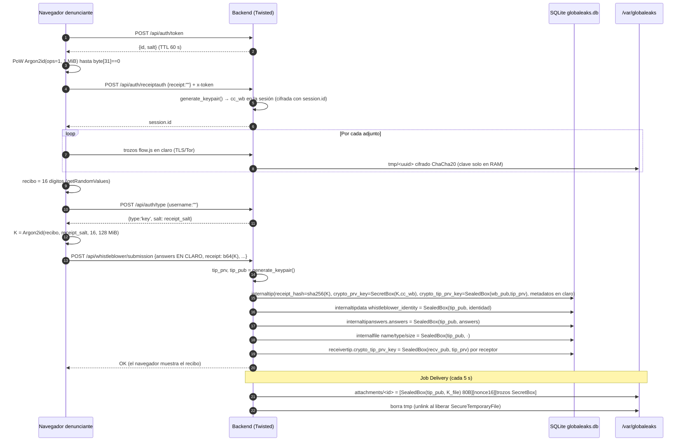
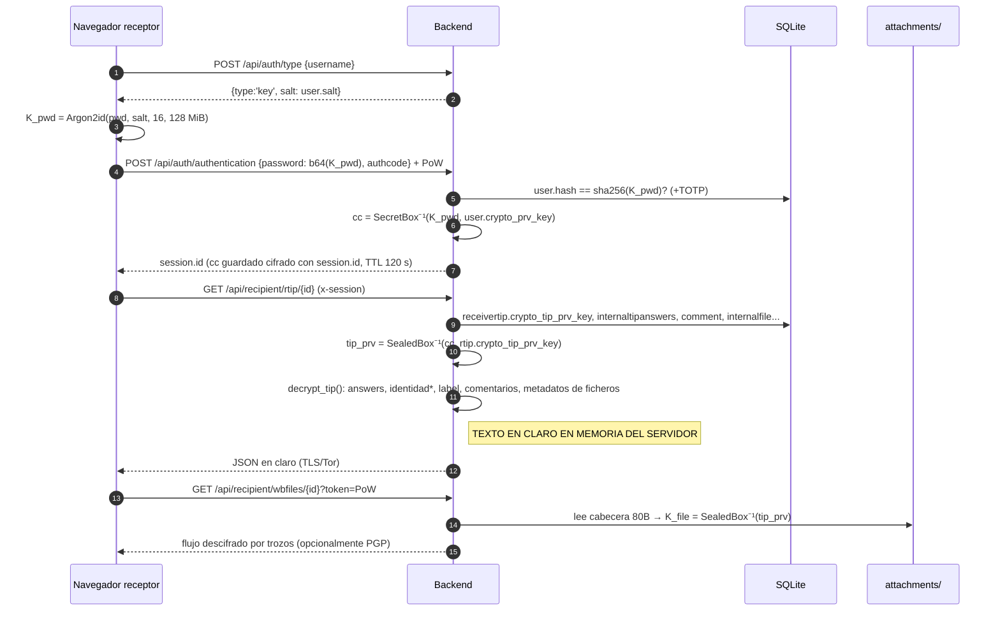
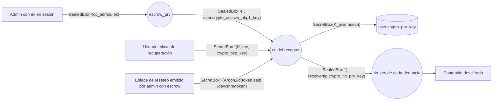

# Cifrado y gestión de claves en Veridy (fork de GlobaLeaks)

Análisis hecho leyendo el código del repositorio `/home/veridy/whistleblowing-software`, rama `feature/kerna-pipeline-azure`, con cambios locales sin commitear (fecha: 2026-10-04).
Las referencias son `ruta:línea` relativas a la raíz del repo. Cuando una referencia apunta a un fichero dentro de un zip, se indica como `zip!ruta:línea`.
Cuando el código y `documentation/` dicen cosas distintas, se sigue el código y la diferencia queda anotada en §13.
Lo que no pude comprobar en el código lleva la marca **[NO VERIFICADO]**.

Abreviaturas:
- **SealedBox**: `nacl.public.SealedBox` (X25519 efímera + XSalsa20-Poly1305, 48 bytes de sobrecarga).
- **SecretBox**: `nacl.secret.SecretBox` (XSalsa20-Poly1305, nonce aleatorio de 24 bytes + MAC de 16 bytes).
- **Argon2id(p, s, ops, mem)**: `crypto_pwhash` de libsodium con salida de 32 bytes. Solo se usan los primeros 16 bytes de la sal.
- `cc`: nombre que da el código a la clave privada Curve25519 de un usuario o de un denunciante, en Base64, cuando ya está descifrada en la sesión.
- `ek`: clave privada de escrow cifrada para el administrador, que viaja en su sesión.

---

## 0. Resumen ejecutivo

1. **El cifrado lo hace el servidor; no es extremo a extremo.** El navegador del denunciante envía las respuestas **en claro** (dentro de TLS o Tor) a `POST /api/whistleblower/submission`, y el backend las cifra antes de escribirlas (`backend/globaleaks/handlers/whistleblower/submission.py:259-262`). Para leer, el backend descifra con la clave privada que guarda en la sesión del receptor y devuelve JSON en claro (`backend/globaleaks/handlers/recipient/rtip.py:1154-1164`). En el navegador solo se hacen cálculos Argon2id: derivación de claves desde contraseña o recibo, y la prueba de trabajo.
2. **Jerarquía de claves:** cada usuario y cada denunciante tiene un par Curve25519. La clave privada se guarda con SecretBox, cifrada con una clave derivada de la contraseña o del recibo. Cada denuncia tiene su propio par Curve25519 (`crypto_tip_pub_key`/`crypto_tip_prv_key`). Todo el contenido de la denuncia se cifra con SealedBox hacia la clave pública de la denuncia. La clave privada de la denuncia se guarda una vez por cada persona con acceso (denunciante, cada receptor y, si hay solicitud de identidad, cada custodio), cifrada con SealedBox hacia la clave pública de esa persona.
3. **Adjuntos:** cada fichero lleva una clave simétrica aleatoria de 32 bytes, cifrada con SealedBox hacia la clave pública de la denuncia en la cabecera del fichero (80 bytes). El contenido va en trozos SecretBox con nonce derivado (`backend/globaleaks/utils/crypto.py:86-141`).
4. **Contraseñas (flujo actual):** el cliente calcula `Argon2id(pwd, salt_usuario, 16, 128 MiB)` y envía el resultado (32 bytes en Base64). El servidor guarda `sha256(clave)` como `User.hash` y usa la clave directamente con SecretBox para la clave privada del usuario (`backend/globaleaks/handlers/auth/__init__.py:107-132`, `backend/globaleaks/handlers/user/operation.py:23-42`).
5. **Recibo:** 16 dígitos decimales generados **en el navegador** (unos 53 bits). El cliente calcula `Argon2id(recibo, receipt_salt_del_tenant, 16, 128 MiB)`, y el servidor guarda `sha256` de ese resultado en `InternalTip.receipt_hash`.
6. **Escrow (opcional; viene marcado por defecto en el asistente de instalación):** con el escrow activo, un administrador puede descifrar la clave privada de cualquier usuario y, a partir de ella, todas sus denuncias. El escrow del tenant 1 funciona como llave maestra de todos los tenants.
7. **Quedan en claro en la base** todos los metadatos: fechas, contexto o canal, estado y subestado, receptores asignados, score, tor/móvil, número de accesos, si se dio identidad o no, autores y fechas de comentarios, rangos de redacción, auditoría, correos de usuarios, secreto TOTP, clave TLS, clave onion y contraseña SMTP. Detalle en §10.
8. **Para Kerna:** en el servidor solo hay texto en claro **en memoria**, durante dos momentos: (a) la petición de envío, antes de cifrar, y (b) cada petición de un receptor (o del denunciante) que descifra la denuncia. En disco y en la base nunca hay texto en claro mientras el cifrado esté activo. Opciones en §11.
9. **El cifrado se puede desactivar:** `encryption` vale `True` por defecto (`backend/globaleaks/models/config_desc.py:57`). La interfaz no deja apagarlo, pero el backend acepta `encryption: false` en `PUT /api/admin/node` (§12).

---

## 1. Primitivas y bibliotecas

| Biblioteca | Versión fijada | Dónde | Uso |
|---|---|---|---|
| PyNaCl (libsodium) | `pynacl==1.5.0` (`backend/requirements.txt:11`); Debian: `python3-nacl` sin versión (`debian/control:33`) | `backend/globaleaks/utils/crypto.py:13-18` | Argon2id (`nacl.pwhash.argon2id.kdf`, `crypto.py:214`), SealedBox/PrivateKey/PublicKey Curve25519 (`crypto.py:241-287`), SecretBox XSalsa20-Poly1305 (`crypto.py:255-269`), RNG `nacl.utils.random` (`crypto.py:49-53,190,200`) |
| cryptography (pyca) | `cryptography==43.0.0` (`requirements.txt:3`); Debian `python3-cryptography` (`debian/control:30`) | `crypto.py:10-11,38-46,169-176`; `backend/globaleaks/utils/securetempfile.py:3-5,25`; `backend/globaleaks/utils/tls.py:45-70`; `backend/globaleaks/utils/onion.py:3-4,26` | SHA-256 (`crypto.py:44`), comparación en tiempo constante (`crypto.py:176`), ChaCha20 para ficheros temporales (`securetempfile.py:25`), claves RSA/EC para TLS y ACME (`tls.py:45-70`), Ed25519 para onion v3 (`onion.py:26`) |
| pyOpenSSL | `pyOpenSSL==25.0.0` (`requirements.txt:10`) | `backend/globaleaks/utils/tls.py:192-275` | Contexto del servidor TLS, cifrados, SNI |
| acme / josepy | `acme==4.0.0`, `josepy==2.0.0` (`requirements.txt:1,7`) | `backend/globaleaks/utils/letsencrypt.py:15-68` | Let's Encrypt (reto HTTP-01) |
| python-gnupg | `python_gnupg==0.5.4` (`requirements.txt:14`); Debian `python3-gnupg` (`debian/control:31`) | `backend/globaleaks/utils/pgp.py:7-71` | PGP opcional del cuerpo de los correos y de las descargas |
| pyotp | `pyotp==2.9.0` (`requirements.txt:13`) | `crypto.py:80-83` | TOTP RFC 6238 |
| txtorcon / tor | `txtorcon==24.8.0` (`requirements.txt:17`); dependencia `tor` (`debian/control:42`) | `backend/globaleaks/services/tor.py:45-85` | Servicios onion v3 efímeros |
| Python stdlib `secrets`, `random.SystemRandom`, `hashlib` | — | `crypto.py:56-77,178-193`; `backend/globaleaks/utils/fs.py:46` | Contraseñas aleatorias, recibo en el servidor (solo en el flujo de operador), sal determinista, patrón aleatorio de `srm` |
| libsodium-wrappers-sumo (cliente) | `0.7.15` (`client/package.json:53`) | `client/app/workers/crypto.worker.ts:1-31` | Argon2id en el navegador (Web Worker) |
| WebCrypto (cliente) | navegador | `client/app/src/shared/services/crypto.service.ts:40-81`; `client/app/src/shared/partials/enable-2fa/enable-2fa.ts:37-41` | `getRandomValues` (recibo, secreto TOTP) y SHA-256 (sal determinista) |

La aplicación (backend y cliente) **no usa** OpenPGP.js, scrypt, PBKDF2 ni secretstream. Hay un `argon2_cffi` en `venv/`, pero ese venv pertenece al script `etl_incremental.py`, no a la aplicación.

---

## 2. Jerarquía de claves y campos de base de datos

### 2.1 Claves de usuario interno (admin, receptor, custodio, analista)

Tabla `user` (`backend/globaleaks/models/__init__.py:930-983`):

| Campo | Contenido | Cómo se genera o cifra |
|---|---|---|
| `salt` (`:940`) | Sal de 16 bytes en Base64 | Determinista: `SHA256(receipt_salt + ":" + username)[:16]` (`backend/globaleaks/handlers/admin/user.py:50-51`, `crypto.py:186-193`) |
| `hash` (`:941`) | `sha256(clave_derivada)` en hex (64 caracteres) | `admin/user.py:65`, `user/operation.py:23-30`. En el formato heredado son 44 caracteres Base64 de Argon2id (`auth/__init__.py:108-112`) |
| `crypto_pub_key` (`:953`) | Clave pública X25519 en Base64 | `GCE.generate_keypair` (`crypto.py:237-244`) |
| `crypto_prv_key` (`:952`) | `Base64(SecretBox(K_pwd, cc))`, donde `cc` es la clave privada en Base64 | `user/operation.py:42`, `admin/user.py:88`, `admin/operation.py:203` |
| `crypto_bkp_key` (`:955`) | `Base64(SecretBox(K_rec, cc))` | `crypto.py:247-252` (`generate_recovery_key`) |
| `crypto_rec_key` (`:954`) | `Base64(SealedBox(user_pub, K_rec))`: la clave de recuperación, cifrada para el propio usuario | `crypto.py:251-252` |
| `crypto_escrow_prv_key` (`:956`) | `Base64(SealedBox(user_pub, escrow_prv))`: solo en administradores con escrow | `backend/globaleaks/handlers/admin/operation.py:86,136`; `backend/globaleaks/handlers/admin/tenant.py:183` |
| `crypto_escrow_bkp1_key` (`:957`) | `Base64(SealedBox(escrow_pub_tenant1, cc))` | `user/operation.py:44-47`, `admin/user.py:97-98`, `admin/operation.py:88-91` |
| `crypto_escrow_bkp2_key` (`:958`) | `Base64(SealedBox(escrow_pub_tenantN, cc))` (solo si tid≠1) | `user/operation.py:49-52`, `admin/user.py:100-101` |
| `two_factor_secret` (`:973`) | Secreto TOTP Base32 de 160 bits, **en claro** | `user/operation.py:115` |
| `pgp_key_public`, `pgp_key_fingerprint`, `pgp_key_expiration` (`:977-979`) | Clave PGP pública | `backend/globaleaks/handlers/user/__init__.py:16-35` |

Cuándo se crean las claves del usuario:
- **Sin escrow:** al crear el usuario no se generan claves. En el primer login con `encryption` activo se genera un par temporal en memoria y se obliga a cambiar la contraseña (`auth/__init__.py:133-139`). Al cambiarla, `change_password` fija `crypto_pub_key`, `crypto_bkp_key`, `crypto_rec_key` y `crypto_prv_key` (`user/operation.py:35-42`). Si el login llega por enlace de reseteo sin escrow, el par se genera en `backend/globaleaks/handlers/user/reset_password.py:147-148`.
- **Con escrow** (en el tenant 1 o en el propio): el par se genera **al crear el usuario**, y la clave privada queda cifrada con la contraseña aleatoria o la indicada por el administrador (`admin/user.py:83-101`). La condición `encryption and esc1 or escN` (`admin/user.py:86`) se agrupa en Python como `(encryption and esc1) or escN`.

### 2.2 Claves del denunciante (recibo)

Tabla `internaltip` (`models/__init__.py:612-650`). Ya no existe una tabla `WhistleblowerTip`: los datos del denunciante viven en `InternalTip`.

| Campo | Contenido | Ref. |
|---|---|---|
| `receipt_hash` (`:638`, UNIQUE por tenant `:648`) | `sha256(K_rec)` en hex (flujo actual), o Argon2id en Base64 de 44 caracteres (flujo heredado) | `submission.py:228-234` |
| `crypto_pub_key` (`:640`) | Clave pública X25519 del denunciante | `submission.py:244` |
| `crypto_prv_key` (`:639`) | `Base64(SecretBox(K_recibo, cc_wb))` | `submission.py:245`; al cambiar el recibo: `backend/globaleaks/handlers/whistleblower/wbtip.py:165` |

El par del denunciante se genera **en el servidor al abrir la sesión de envío**, antes de que exista el recibo (`backend/globaleaks/sessions.py:112-114`, llamado desde `auth/__init__.py:267`).

### 2.3 Claves de la denuncia (tip)

| Campo | Contenido | Ref. |
|---|---|---|
| `InternalTip.crypto_tip_pub_key` (`models:641`) | Clave pública X25519 de la denuncia (en claro) | `submission.py:243` |
| `InternalTip.crypto_tip_prv_key` (`models:642`) | `Base64(SealedBox(wb_pub, tip_prv))`: copia del denunciante | `submission.py:246` |
| `ReceiverTip.crypto_tip_prv_key` (`models:771`) | `Base64(SealedBox(receiver_pub, tip_prv))`: copia de cada receptor | `submission.py:280-286`, `submission.py:146-155` |
| `IdentityAccessRequestCustodian.crypto_tip_prv_key` (`models:584`) | `Base64(SealedBox(custodian_pub, tip_prv))`: se crea cuando un receptor pide la identidad | `rtip.py:963-978` |
| `InternalTip.deprecated_crypto_files_pub_key` / `ReceiverTip.deprecated_crypto_files_prv_key` (`models:643,772`) | Par heredado de versiones antiguas que se usaba solo para ficheros. Hoy solo se lee como alternativa | `rtip.py:96-99,1276-1285`; `backend/globaleaks/handlers/recipient/export.py:157-160` |

Cuando un receptor con acceso concede acceso a otro (`grant`/`transfer`), descifra la clave privada de la denuncia con su `cc` y la vuelve a cifrar hacia la clave pública del nuevo receptor (`rtip.py:85-99`). Si el nuevo receptor todavía no tiene `crypto_pub_key`, la operación se rechaza (`rtip.py:85-87`).

### 2.4 Claves de ficheros

Cada adjunto, del denunciante o del receptor, tiene una clave aleatoria de 32 bytes (`crypto.py:98`), cifrada con SealedBox hacia `crypto_tip_pub_key` y guardada en los primeros 80 bytes del fichero (`crypto.py:100-102`). No se guarda en la base. Formato completo en §5.

### 2.5 Claves de tenant y de plataforma (tabla `config`, `models:249-290`)

| `var_name` | Contenido | Ref. |
|---|---|---|
| `receipt_salt` | Sal aleatoria de 16 bytes en Base64, **pública** (se expone en `public_node`) | `config_desc.py:89,334`; `crypto.py:186-193` |
| `crypto_escrow_pub_key` | Clave pública de escrow del tenant | `admin/operation.py:79-82`; `admin/tenant.py:161-164` |
| `crypto_escrow_prv_key` | Solo en tid≠1: `Base64(SealedBox(escrow_pub_tenant1, escrow_prv_tenantN))` | `admin/operation.py:95-97`; `admin/tenant.py:166-167` |
| `encryption` | Booleano, por defecto `True` | `config_desc.py:57` |
| `https_key`, `https_cert`, `https_chain`, `https_selfsigned_key/cert`, `acme_accnt_key` | Claves TLS en PEM, **en claro** | `config_desc.py:33-34,62-69`; `backend/globaleaks/handlers/admin/https.py:53-58,90-103` |
| `tor_onion_key` | Clave Ed25519 expandida del onion v3, **en claro** | `config_desc.py:121`; `admin/operation.py:48-52`; `onion.py:39` |
| `smtp_password` | **En claro** (por defecto `'globaleaks'`) | `config_desc.py:96` |

### 2.6 Claves en memoria: sesiones, tokens y temporales

- **Sesión:** `id` = 32 bytes aleatorios en hex (`sessions.py:13`). El diccionario de sesiones se indexa por `sha256(id)`, y `cc` y `ek` se guardan cifrados con `SecretBox(key=bytes.fromhex(id))` (`sessions.py:45-56,81-99`). El TTL del servidor es de 120 s (`backend/globaleaks/settings.py:40`, `sessions.py:109`) y se renueva con `POST /api/auth/session` más una prueba de trabajo (`auth/__init__.py:286-296`). El cliente lo hace cada 30 s y cierra la sesión tras 1800 s de inactividad (`client/app/src/pages/app/app.component.ts:160-176`).
- **Token de prueba de trabajo** (`backend/globaleaks/utils/token.py:10-30`, `backend/globaleaks/state.py:97`): TTL de 60 s. `TokenHandler` guarda en el token el objeto de sesión **ya descifrado** (`backend/globaleaks/handlers/auth/token.py:17`, `token.py:37-38`). Mientras el token existe (como mucho 60 s), `cc` está en memoria sin la protección de `Session.encrypt`.
- **Ficheros temporales de subida:** se cifran con ChaCha20, con clave y nonce aleatorios que solo viven en RAM (`securetempfile.py:25`). No hay autenticación (no es AEAD).
- **Tokens de reseteo:** fichero `/dev/shm/globaleaks/<token>` (`settings.py:36`). Contiene `user_id` y, si un administrador con escrow generó el reseteo, `":" + Base64(SecretBox(Argon2id(token, user.salt), cc))` (`admin/operation.py:217-234`, `reset_password.py:21-41`).

### 2.7 Diagrama: jerarquía de claves

```mermaid
flowchart TD
    subgraph Credenciales
        PWD[Contraseña usuario] -->|"Argon2id ops=16 mem=128MiB<br/>sal = SHA256(receipt_salt:username)[:16]<br/>(en el navegador)"| KPWD[K_pwd 32B]
        REC[Recibo 16 dígitos] -->|"Argon2id ops=16 mem=128MiB<br/>sal = receipt_salt del tenant<br/>(en el navegador)"| KREC[K_recibo 32B]
        RK[Clave de recuperación 32B<br/>mostrada en Base32]
    end

    KPWD -->|sha256| UH[(User.hash)]
    KREC -->|sha256| RH[(InternalTip.receipt_hash)]

    KPWD -->|SecretBox| UPRV[(User.crypto_prv_key)]
    RK -->|SecretBox| UBKP[(User.crypto_bkp_key)]
    UPRV --> UCC((cc usuario<br/>X25519 privada))
    UBKP --> UCC
    UCC -. pública .-> UPUB[(User.crypto_pub_key)]
    UPUB -->|SealedBox de RK| UREC[(User.crypto_rec_key)]

    KREC -->|SecretBox| WPRV[(InternalTip.crypto_prv_key)]
    WPRV --> WCC((cc denunciante<br/>X25519 privada))
    WCC -. pública .-> WPUB[(InternalTip.crypto_pub_key)]

    TIP((tip_prv<br/>X25519 por denuncia)) -. pública .-> TPUB[(InternalTip.crypto_tip_pub_key)]
    WPUB -->|SealedBox de tip_prv| ITK[(InternalTip.crypto_tip_prv_key)]
    UPUB -->|SealedBox de tip_prv| RTK[(ReceiverTip.crypto_tip_prv_key)]
    UPUB -->|"SealedBox de tip_prv (custodio)"| IARK[(IdentityAccessRequestCustodian.crypto_tip_prv_key)]

    TPUB -->|SealedBox| DATA["Respuestas, identidad, label, comentarios,<br/>metadatos de ficheros, motivaciones IAR"]
    TPUB -->|SealedBox de K_file| FHDR[Cabecera 80B del fichero]
    FHDR --> KF((K_file 32B aleatoria))
    KF -->|SecretBox por trozos| FILE[/attachments/&lt;id&gt;/]

    subgraph Escrow opcional
        EPRV((escrow_prv tenant)) -. pública .-> EPUB[(Config.crypto_escrow_pub_key)]
        EPUB -->|SealedBox de cc| EB1[(User.crypto_escrow_bkp1_key / bkp2)]
        UPUB -->|"SealedBox de escrow_prv (solo admins)"| UEK[(User.crypto_escrow_prv_key)]
        E1PUB[escrow_pub tenant 1] -->|"SealedBox de escrow_prv tenant N"| CEP[(Config.crypto_escrow_prv_key tid≠1)]
    end
```



---

## 3. Derivación desde contraseñas, autenticación y antispam

### 3.1 Parámetros de Argon2id

- Servidor: `_GCE.options = {'OPSLIMIT': 16, 'MEMLIMIT': 27}`, es decir, 16 iteraciones y 2^27 B = 128 MiB (`crypto.py:163-166`). Salida de 32 bytes con los primeros 16 bytes de la sal decodificada (`crypto.py:213-216`). Un `threading.Lock` global serializa todos los Argon2id del servidor (`crypto.py:24,210-219`).
- Cliente: `hashArgon2(text, salt, iterations = 16, memory = 1 << 27)` (`client/app/src/shared/services/crypto.service.ts:83`), que en el worker llama a `crypto_pwhash(32, …, ALG_ARGON2ID13)` y también recorta la sal a 16 bytes (`client/app/workers/crypto.worker.ts:3-19`). El worker tiene su propia CSP con `script-src 'wasm-unsafe-eval'` (`backend/globaleaks/rest/api.py:569-580`).
- `calculate_key_and_hash` (flujo heredado, todo en el servidor): **clave** = Argon2id ops **17**; **hash** = Argon2id ops **16**. Son dos derivaciones independientes (`crypto.py:228-234`).
- `derive_key`: Argon2id ops 16. Se usa para contraseñas generadas por el servidor y para la clave temporal de reseteo (`crypto.py:221-226`; `admin/user.py:60-61`; `backend/globaleaks/handlers/signup.py:135-141`; `admin/operation.py:226`).

### 3.2 Login de usuarios internos

1. El cliente llama a `POST /api/auth/type` con el `username`. El servidor devuelve `{'type': 'key', 'salt': user.salt}`. Si el usuario no existe, devuelve una sal determinista calculada con `receipt_salt` para no revelar si existe; si el hash es heredado, devuelve `{'type': 'password'}` (`auth/__init__.py:158-177`).
2. Con `type == 'key'`, el cliente sustituye la contraseña por `hashArgon2(password, salt)` (`client/app/src/services/helper/authentication.service.ts:106-115`).
3. El servidor: si `len(user.hash) == 64`, calcula `key = b64decode(password)` y `hash = sha256(key)`; si no, aplica `calculate_key_and_hash` (`auth/__init__.py:107-112`). Compara en tiempo constante (`auth/__init__.py:116`, `crypto.py:168-176`). Comprueba TOTP (`auth/__init__.py:121-125`) y descifra `crypto_prv_key` con `key` (`auth/__init__.py:130-132`). Si el hash era heredado, fuerza el cambio de contraseña (`auth/__init__.py:127-128`).
4. Se crea la sesión con `cc` (clave privada en claro) y `ek = user.crypto_escrow_prv_key` (`auth/__init__.py:150`).

Consecuencias:
- El servidor **nunca recibe la contraseña** en el flujo `key`, pero sí recibe en cada login la clave `K_pwd`, que es la que descifra la clave privada. Para un servidor comprometido en caliente, `K_pwd` vale lo mismo que la contraseña.
- La sal de cada usuario es pública y determinista (`receipt_salt` + username) y no cambia al cambiar la contraseña.
- La complejidad de la contraseña **solo** se comprueba en el cliente (`client/app/src/shared/directive/password-strength-validator.directive.ts`). El servidor solo recibe la clave derivada y no puede validarla. `change_password` tampoco comprueba el argumento `current` que envía el cliente (`user/operation.py:17-30` frente a `client/app/src/shared/partials/password-change/password-change.component.ts:47-53`).
- Las operaciones sensibles (`disable_2fa`, `get_recovery_key`, `toggle_escrow`, etc.) piden confirmación por la cabecera `X-Confirmation`: un código TOTP si el usuario tiene 2FA, o la clave derivada (`backend/globaleaks/handlers/base.py:86-98,302-308`; `backend/globaleaks/handlers/user/operation.py:152-155`; `admin/operation.py:262-269`). **Posible bug:** para hashes heredados se llama a `GCE.hash_password` (`base.py:95`), que no existe en `crypto.py`. Solo afectaría a cuentas con hash heredado.

### 3.3 Recibo del denunciante

- **Generación:** en el navegador, `generateReceipt()`: 16 bytes de `crypto.getRandomValues`, cada uno reducido con `% 10` (`crypto.service.ts:40-44`). El sesgo de módulo es despreciable (los dígitos 0-5 salen con p=26/256 y los 6-9 con p=25/256): unos **53,15 bits** de entropía frente a 53,15 ideales. En el servidor, `GCE.generate_receipt()` (`crypto.py:178-183`, con `random.SystemRandom`) solo se usa para el recibo nuevo en sesiones de operador (`auth/__init__.py:74-75`).
- **Envío:** el cliente pide `auth/type` con usuario vacío. Si `type == 'key'`, manda `receipt = Argon2id(recibo, receipt_salt)` en Base64 (44 caracteres); si no, manda el recibo en claro (`client/app/src/pages/whistleblower/submission/submission.component.ts:311-321`).
- **Servidor:** con 44 caracteres, `K = b64decode(receipt)` y `receipt_hash = sha256(K)`; en otro caso aplica `calculate_key_and_hash(receipt, receipt_salt)` (`submission.py:228-234`). Después `crypto_prv_key = SecretBox(K, cc_wb)` (`submission.py:245`).
- **Login con recibo:** `auth/__init__.py:31-77`. El modo de todo el tenant se decide así: si existe **alguna** `InternalTip` con `length(receipt_hash) < 64`, todo el tenant pasa al modo `password`, con KDF en el servidor (`auth/__init__.py:42-47,162-164`).
- **Posible bug [NO VERIFICADO en ejecución]:** `change_receipt` siempre usa `calculate_key_and_hash` (`wbtip.py:158`), y eso escribe un `receipt_hash` heredado de 44 caracteres. En cuanto se cambia un recibo (flujo de operador, `auth/__init__.py:66-75`; `client/app/src/services/helper/authentication.service.ts:139-150`), el tenant entero pasaría al modo `password`. Las denuncias que se crearon con el hash nuevo (sha256, 64 caracteres) dejarían de coincidir en `login_whistleblower`, porque el servidor calcularía Argon2id en vez de `sha256(K)`.
- La sal del recibo es **una por tenant** y es pública. Un atacante con la base puede probar cada candidato contra **todas** las denuncias del tenant con un único Argon2id de 128 MiB.
- `login_whistleblower` asigna `itip.wb_last_access` (`auth/__init__.py:58`), pero el modelo no tiene esa columna: ese dato no se guarda.

### 3.4 2FA / TOTP

- El secreto lo genera el navegador: 32 símbolos de un alfabeto Base32 tomados de `Uint32Array(32)` con `crypto.getRandomValues`, es decir, 160 bits (`client/app/src/shared/partials/enable-2fa/enable-2fa.ts:25,37-41`). El servidor lo valida con un código antes de guardarlo (`user/operation.py:96-117`).
- Verificación: `pyotp.TOTP(secret).verify(token, valid_window=1)`, con paso de 30 s y ±1 ventana (`crypto.py:80-83`). Hay antirreplay: el último código válido de cada secreto se recuerda 120 s (`state.py:99,299-316`).
- `User.two_factor_secret` se guarda **en claro** en la base (`models:973`).

### 3.5 Prueba de trabajo antispam (hashcash con Argon2id)

- `POST /api/auth/token` devuelve `{id, salt}`: dos valores de 32 bytes aleatorios en hex (`token.py:10-23`; `auth/token.py:12-17`). El TTL es de 60 s (`state.py:97`).
- El cliente busca un `counter` tal que `Argon2id(id + str(counter), salt, ops=1, mem=1 MiB)[31] == 0`: en promedio, 256 intentos (`crypto.service.ts:102-117`). Lo envía en `x-token: id:answer`.
- El servidor valida y consume el token, que es de un solo uso (`token.py:25-30,51-59`; `base.py:132-145`).
- El interceptor exige la prueba en `api/signup`, `api/auth/receiptauth` (sin sesión), `api/wizard`, `api/auth/authentication`, `api/auth/type`, `api/auth/tokenauth`, `api/user/reset/password`, `api/recipient/rtip` y `api/support` (`client/app/src/services/root/app-interceptor.service.ts:20-28,71-80`). También en las renovaciones de sesión y en las descargas por URL (`client/app/src/shared/services/utils.service.ts:745-761`).
- Detalle curioso: la "sal" del token es hex, pero se decodifica como Base64 en ambos lados (`crypto.py:213`, `crypto.worker.ts:5-7`). Funciona porque cliente y servidor hacen lo mismo.
- Límites de frecuencia en memoria por IP, tenant y sistema (`backend/globaleaks/rest/decorators.py:79-140`; umbrales en `config_desc.py:106-120`). No encontré en el código la espera de hasta 42 s tras logins fallidos que describe la documentación: `failed_login_attempts` se cuenta (`auth/__init__.py:24`) pero no se usa para retrasar nada.

---

## 4. Secuencia de una denuncia

### 4.1 Envío

1. **Abrir sesión de envío:** `POST /api/auth/receiptauth` con `receipt` vacío y prueba de trabajo, que llama a `initialize_submission_session`. El servidor genera el par X25519 del denunciante y guarda la privada como `cc` de la sesión (`auth/__init__.py:263-267`; `sessions.py:112-114`).
2. **Adjuntos (opcionales):** se suben en claro, en trozos con flow.js (chunk de 1000 KiB, `utils.service.ts:768-770`), a `POST /api/whistleblower/submission/attachment`. Cada trozo se escribe en un `SecureTemporaryFile` (ChaCha20 con clave en RAM) en `/var/globaleaks/tmp/<uuid>` (`base.py:356-408`; `settings.py:87`). El descriptor del fichero (nombre, tipo y tamaño en claro) se añade a `session.files` (`backend/globaleaks/handlers/whistleblower/attachment.py:61-63`).
3. **Recibo:** el navegador genera el recibo y calcula Argon2id (§3.3).
4. **`POST /api/whistleblower/submission`** con `answers` **en claro**, `receivers`, `context_id`, `score`, `identity_provided` y `receipt` (`backend/globaleaks/rest/requests.py:107-124`; `submission.py:308-318`). Dentro de `db_create_submission`, en este orden:
   1. Se filtran los receptores: si el cifrado está activo, solo entran los que tienen `crypto_pub_key` (`submission.py:172-192`).
   2. Se crea `InternalTip` con los metadatos en claro: estado `'new'`, progresivo, expiración según el contexto, score, tor, móvil, contexto y si hay campo de identidad (`submission.py:197-226`).
   3. Se calcula `K` y `receipt_hash` (`submission.py:228-234`).
   4. Si el cifrado está activo: se genera el par de la denuncia; `crypto_pub_key` = pública del denunciante; `crypto_prv_key = SecretBox(K, cc_wb)`; `crypto_tip_prv_key = SealedBox(wb_pub, tip_prv)` (`submission.py:242-246`).
   5. La respuesta de identidad se separa: `SealedBox(tip_pub, json(identidad))` va a `InternalTipData(key='whistleblower_identity')`, y en `answers` ese campo se deja vacío (`submission.py:249-257`).
   6. `answers` completo → `SealedBox(tip_pub, json(answers))` en Base64 → `InternalTipAnswers.answers` (`submission.py:259-262`). La estructura del cuestionario se guarda en claro en `ArchivedSchema`, indexada por sha256 (`submission.py:133-143,170`).
   7. Metadatos de cada fichero: `name`, `type` y `size` → `SealedBox(tip_pub, …)` → `InternalFile` (`submission.py:264-278`).
   8. Para cada receptor: `ReceiverTip.crypto_tip_prv_key = SealedBox(receiver_pub, tip_prv)` (`submission.py:280-286`).
   9. Auditoría `whistleblower_new_report` (`submission.py:294`).
5. **Entrega de ficheros:** el job `Delivery` corre cada 5 s (`backend/globaleaks/jobs/delivery.py:114-133`). Toma los `InternalFile.new`, crea los `WhistleblowerFile` de cada `ReceiverTip` (`delivery.py:27-70`) y vuelve a cifrar el temporal en `/var/globaleaks/attachments/<ifile.id>` con `crypto_tip_pub_key` (`delivery.py:49-57,100-111`). Si no hay clave (cifrado desactivado), lo copia **en claro** (`delivery.py:88-97,129-132`).
6. **Notificaciones:** se generan correos a los receptores (§7).



### 4.2 Lectura por el receptor

1. Login (§3.2): la sesión guarda `cc_receptor`.
2. **Listado** `GET /api/recipient/rtips`: por cada denuncia accesible, `tip_key = SealedBox⁻¹(cc, rtip.crypto_tip_prv_key)`, y con ella se descifran **label y answers**, que se devuelven en el listado (`backend/globaleaks/handlers/recipient/__init__.py:93-104`). En las denuncias no accesibles (otros receptores del mismo contexto) el texto cifrado se sustituye por "" (`recipient/__init__.py:102-105`).
3. **Detalle** `GET /api/recipient/rtip/<id>`: `db_get_rtip` actualiza `access_date`, pasa el estado de `new` a `opened` y registra `access_report` en la auditoría (`rtip.py:639-665`). Después, `decrypt_tip(cc, rtip.crypto_tip_prv_key, tip)` en un hilo (`rtip.py:1159-1160`, `submission.py:37-82`) descifra: label, answers de cada cuestionario, `whistleblower_identity`, motivaciones de la solicitud de identidad (IAR), contenido de comentarios y `name/description/type/size` de wbfiles y rfiles. La función `redact_report` aplica el enmascarado según permisos (`rtip.py:699-725`).
4. **Descarga de un adjunto** `GET /api/recipient/wbfiles/<id>?token=…`: `tip_prv = SealedBox⁻¹(cc, crypto_tip_prv_key)`, luego el nombre y después `streaming_encryption_open('DECRYPT', tip_prv, path)`. Si falla, prueba la clave heredada. Si el usuario tiene PGP, el fichero se cifra con PGP al vuelo (`rtip.py:1260-1287`; `base.py:337-350`).
5. **Exportación ZIP/PDF**: se descifra todo en el servidor, se arma el ZIP en un `SecureTemporaryFile` y se cifra con PGP si el usuario tiene clave (`backend/globaleaks/handlers/recipient/export.py:146-224`).

Una salvedad: `RTipInstance.get` solo descifra si `State.tenants[tid].cache.encryption` sigue en `True` (`rtip.py:1159`). Si alguien apaga el cifrado más tarde, los receptores recibirían las denuncias antiguas como texto cifrado en Base64. La vista del denunciante descifra sin comprobar ese flag (`wbtip.py:196-197`).



*La identidad solo se entrega si la solicitud de acceso a la identidad está `authorized`; si no, el serializador la borra antes de descifrar (`backend/globaleaks/models/serializers.py:285-293`). Es un control de acceso del servidor, **no** una protección criptográfica: la identidad está cifrada con la misma clave de denuncia que tiene cada receptor (`submission.py:251`).

### 4.3 Qué se cifra en cada objeto (siempre `SealedBox(crypto_tip_pub_key, ·)` en Base64)

| Objeto | Campo cifrado | Ref. |
|---|---|---|
| Respuestas al cuestionario inicial | `InternalTipAnswers.answers` (JSON completo) | `submission.py:259-262` |
| Cuestionario adicional | `InternalTipAnswers.answers` | `wbtip.py:124-140` |
| Identidad del denunciante (inicial o posterior) | `InternalTipData.value` (`key='whistleblower_identity'`) | `submission.py:249-257`; `wbtip.py:104-116` |
| Etiqueta del receptor | `InternalTip.label` | `rtip.py:891-892` |
| Comentarios del receptor | `Comment.content` | `rtip.py:1011-1012` |
| Comentarios del denunciante | `Comment.content` | `wbtip.py:79-95` |
| Comentario redactado | `Comment.content` se reescribe con █ y se vuelve a cifrar | `rtip.py:413-437` |
| Respuestas e identidad redactadas | se reescriben y se vuelven a cifrar | `rtip.py:468-527` |
| Metadatos de adjuntos del denunciante | `InternalFile.name/content_type/size` | `submission.py:265-267`; `attachment.py:34-36` |
| Metadatos de adjuntos del receptor | `ReceiverFile.name/description/content_type/size` | `rtip.py:618-622` |
| Motivación de la solicitud de identidad | `IdentityAccessRequest.request_motivation` | `rtip.py:968-969` |
| Respuesta del custodio | `IdentityAccessRequest.reply_motivation` | `backend/globaleaks/handlers/custodian/__init__.py:91-92` |

Detalle: `create_identityaccessrequest` cifra la motivación sin comprobar si existe `crypto_tip_pub_key` (`rtip.py:968-969`). En denuncias sin cifrar fallaría. `create_redaction` calcula `mask_content` y luego no lo usa (`rtip.py:1037-1044`).

---

## 5. Adjuntos: cifrado en streaming y formato en disco

- **Ubicación:** `/var/globaleaks/attachments/<id>` (`settings.py:86`); en Docker es el volumen `docker_globaleaks` (`docker/docker-compose.yml:17-18`). `<id>` es el UUID del temporal, que coincide con `InternalFile.id` o `ReceiverFile.id` (`base.py:400`, `submission.py:271`, `delivery.py:53-57,79-83`).
- **Formato** (`crypto.py:96-141`):
  ```
  [0..79]   SealedBox(tip_pub, K_file)   (32 de clave efímera + 16 de MAC + 32 de clave)
  [80..95]  partial_nonce (16 B aleatorios)
  Repetido por cada trozo:
     1 B   last (0/1)
     4 B   len (big-endian)
     len+16 B  SecretBox(K_file).encrypt(trozo, nonce)[24:]   (sin el nonce)
  nonce_i     = partial_nonce || uint64_LE(i)
  nonce_final = partial_nonce || uint64_BE(1)
  ```
  El último trozo está vacío y lleva `last=1` (`delivery.py:109`). El tamaño de trozo es `twisted.internet.abstract.FileDescriptor.bufferSize` (`delivery.py:104`); su valor (65 536 B en Twisted) **[NO VERIFICADO]** en este entorno, porque Twisted no está instalado aquí. El flag `last` y el nonce final distinto impiden truncar el fichero sin que se note. El orden de los trozos queda fijado por el índice dentro del nonce.
- **Temporal antes de la entrega:** `SecureTemporaryFile` con ChaCha20 sin MAC, clave y nonce de `os.urandom` que solo viven en memoria (`securetempfile.py:14-25`). El fichero se borra con `unlink` al liberar el objeto (`securetempfile.py:148-156`). Los temporales de más de un día se eliminan con `srm` (`backend/globaleaks/jobs/cleaning.py:84-90`). `TempUploadFiles` caduca a la hora (`state.py:100`).
- **Ficheros del receptor al denunciante:** se cifran igual, con la clave de la denuncia (`delivery.py:72-83`). El docstring del modelo dice que "no se cifra" (`models:1025-1027`); el código actual sí los cifra.
- **Descarga del denunciante:** `wbtip.py:213-285`, con la misma lógica y la clave `cc` del denunciante.
- **Visor en el navegador:** `/viewer/` con CSP `sandbox allow-scripts` y blobs (`api.py:582-600`).

---

## 6. Recuperación de claves, reseteo de contraseña y papel del administrador

### 6.1 Clave de recuperación del usuario

- Se genera con el par del usuario: `K_rec` aleatoria de 32 bytes, `crypto_bkp_key = SecretBox(K_rec, cc)` y `crypto_rec_key = SealedBox(user_pub, K_rec)` (`crypto.py:247-252`).
- El usuario la consulta con `get_recovery_key`, que pide confirmación (`user/operation.py:76-93,152-155`) y la devuelve en Base32 sin relleno, unos 52 caracteres. Al hacerlo se marca `clicked_recovery_key` (`user/operation.py:91`). Si no la ha visto, la interfaz muestra un aviso (`client/app/src/shared/partials/user-warnings/user-warnings.component.html:12`).
- No es un factor independiente: cualquiera con `cc` (o con `K_pwd`) obtiene `K_rec` a partir de `crypto_rec_key`.

### 6.2 Reseteo iniciado por el usuario (sin escrow)

1. `PUT /api/user/reset/password` con nombre de usuario o correo genera un token aleatorio de 256 bits en hex (`crypto.py:49-53`). Se guarda `user_id` en `/dev/shm/globaleaks/<token>` y se envía el enlace por correo (`reset_password.py:21-53,73-92`).
2. En la validación (`reset_password.py:95-166`): si el usuario tiene `crypto_prv_key`, se pide la **clave de recuperación**, que descifra `crypto_bkp_key` y da `cc` (`reset_password.py:121-137`). Si el usuario tiene 2FA, también se pide el código TOTP (`reset_password.py:139-143`). Se crea la sesión con `cc` y se obliga a cambiar la contraseña.
3. `change_password` vuelve a cifrar el **mismo** `cc` con la nueva `K_pwd`, renueva las copias de escrow y borra el token con `srm` (`user/operation.py:35-58`).
4. Sin clave de recuperación, sin escrow y con `crypto_prv_key`, el resultado es `require_recovery_key` y **no hay forma de recuperar** las denuncias de ese usuario.

### 6.3 Escrow

- **Activación:** en el asistente de instalación, `admin_escrow` viene **marcado por defecto** en el cliente (`client/app/src/pages/wizard/wizard/wizard.component.ts:65`). Se puede cambiar después con la operación `toggle_escrow`, que pide confirmación (`admin/operation.py:71-110,262-269`).
- **Al activar** (`admin/operation.py:78-99`, `admin/tenant.py:161-183`):
  - Se genera el par de escrow del tenant y se publica `crypto_escrow_pub_key`.
  - `admin.crypto_escrow_prv_key = SealedBox(admin_pub, escrow_prv)`.
  - Se guarda la copia `bkp1` (tenant 1) o `bkp2` (tenant N) del administrador que activa.
  - En el tenant N, `Config.crypto_escrow_prv_key = SealedBox(escrow_pub_tenant1, escrow_prv_N)`.
  - Se marca `password_change_needed=True` a todos los demás usuarios, para que su próximo `change_password` cree su `bkp1`/`bkp2` (`user/operation.py:44-52`).
  - Detalle: `toggle_escrow` asigna `user_session.ek = user.crypto_escrow_prv_key` **antes** de actualizar el campo (`admin/operation.py:85-86`), así que la sesión actual queda con el valor anterior hasta el siguiente login [comportamiento deducido del código].
- **Al desactivar:** se vacían `bkp1`/`bkp2` y `crypto_escrow_prv_key` de todos los usuarios afectados, junto con la configuración (`admin/operation.py:101-110`).
- **Delegar el escrow a otro admin:** `toggle_user_escrow` lo hace; requiere que quien opera tenga `ek`, y bloquea que alguien se lo quite a sí mismo (`admin/operation.py:113-138`). El admin raíz con escrow puede abrir el escrow de un tenant N con `Config.crypto_escrow_prv_key` (`admin/operation.py:133-134`).
- **Capacidades de un admin con `ek`:**
  - `set_user_password`: `escrow_prv = SealedBox⁻¹(cc_admin, ek)`, luego `cc_user = SealedBox⁻¹(escrow_prv, user.crypto_escrow_bkp1/2_key)`, y `user.crypto_prv_key = SecretBox(nueva K_pwd, cc_user)` (`admin/operation.py:186-209`). Como el admin fija la contraseña, puede entrar como ese usuario y leer todas sus denuncias, salvo que el usuario tenga 2FA. La acción se registra en auditoría (`admin/operation.py:209`). Si el admin no tiene `ek` y el usuario tiene claves, la operación **no hace nada y no avisa** (`admin/operation.py:190-191`).
  - `send_password_reset_email`, o crear usuario con enlace de activación: `set_tmp_key` escribe en `/dev/shm` `SecretBox(Argon2id(token, user.salt), cc_user)` (`admin/operation.py:217-245`; `admin/user.py:91-92`). Quien tenga el **enlace del correo** recupera `cc` **sin** clave de recuperación (`reset_password.py:129-131`). Solo lo frena el 2FA, si está activo. El token caduca a los 7 días (`cleaning.py:92-97`).
  - Borrar un usuario que tiene escrow requiere `ek` (`admin/user.py:113-115`).
- **Alcance multitenant:** `change_password` siempre guarda `bkp1` con la clave pública de escrow del **tenant 1** (`user/operation.py:44-47`). Por eso el escrow raíz da acceso a las claves de los usuarios de **todos** los tenants.
- El administrador **no tiene** ningún endpoint para leer denuncias directamente. Su acceso pasa por suplantar al usuario: fijarle la contraseña o usar el enlace de reseteo.



---

## 7. PGP y notificaciones por correo

- **PGP:** si el usuario tiene `pgp_key_public`, el **cuerpo** del correo se cifra con python-gnupg (`--trust-model always`). Si el cifrado falla, el cuerpo queda vacío (`backend/globaleaks/utils/templating.py:657-661`; `pgp.py:13-71`). El **asunto nunca se cifra**. Las descargas y exportaciones también se cifran con PGP en ese caso (`base.py:337-350`; `export.py:224`). El job `PGPCheck` borra las claves caducadas y avisa (`backend/globaleaks/jobs/pgp_check.py:63-84`).
- **Qué va en claro con las plantillas por defecto** (`client/app/assets/data/appdata.json`, claves `tip_mail_title`/`tip_mail_template`): asunto `"{TipNum} - New report"`, con `{TipNum}` antepuesto en `templating.py:651-652`; nombre del receptor, URL de la plataforma y nombre del nodo. El texto de la denuncia **no** aparece. Las palabras clave `{TipLabel}`, `{QuestionnaireAnswers}` y `{Comments}` existen (`templating.py:36-44,323-357`), pero el job de notificación serializa la denuncia **sin descifrarla** (`backend/globaleaks/jobs/notification.py:200-201`): si un admin las metiera en una plantilla, saldría texto cifrado en Base64. Esto se deduce del código; **[NO VERIFICADO]** con una prueba.
- **Cola de correo:** tabla `mail` con `address`, `subject` y `body` en claro (o PGP) hasta que se envía. Después se borra (`notification.py:259-266`); los que no salen se purgan a los 14 días (`cleaning.py:45`).
- **SMTP:** por defecto `mail.globaleaks.org:587` con TLS y credenciales `globaleaks/globaleaks` (`config_desc.py:94-102`; `admin/operation.py:165-173`). Si nadie cambia esto, los metadatos de las notificaciones pasan por el servidor de GlobaLeaks. La conexión SMTP verifica el certificado (`backend/globaleaks/utils/tls.py:214-243`; `backend/globaleaks/utils/mail.py:74-91`) y puede ir por Tor (`anonymize_outgoing_connections`, `config_desc.py:37`).
- **Correos con secretos:** el de activación de signup lleva las **contraseñas iniciales en claro** (`signup.py:163-170`); el de reseteo o activación lleva el token, que con escrow equivale a la clave (§6.3); el de validación de correo lleva el token de cambio (`backend/globaleaks/handlers/user/__init__.py:136-150`).

---

## 8. Transporte

- **TLS** (`backend/globaleaks/utils/tls.py`):
  - TLS ≥1.2: se desactivan SSLv2/3 y TLS 1.0/1.1; preferencia del servidor; prioridad a ChaCha; sin compresión ni renegociación (`tls.py:192-211`).
  - Lista de cifrados AEAD con ECDHE (`tls.py:27-35`) y `ecdh_auto` (`tls.py:265-269`).
  - Clave del servidor generada: EC P-384 (`tls.py:61-70`, `https.py:90-92`).
  - Autofirmado P-384 por defecto, para `127.0.0.1` (`tls.py:79-81`, `admin/tenant.py:55-57`, `https.py:33-37`).
- **Let's Encrypt:** ACME v2, reto HTTP-01 (`letsencrypt.py:15-30,68`), cuenta RSA de 4096 bits (`https.py:53-58`, `settings.py:53,79`). La renovación y la comprobación las hace el job `certificate_check` (`backend/globaleaks/jobs/certificate_check.py:65-96`). Toda la configuración TLS (claves incluidas) se guarda **en claro** en `config` (§2.5).
- **Redirección:** toda petición sin TLS que no sea `.onion` ni reto ACME se redirige a HTTPS (`api.py:256-262,426-428`). Sin certificado configurado, el destino usa el autofirmado. El cliente exige `isSecureContext` y `crypto.subtle` (`client/app/src/shared/services/browser-check.service.ts:33`).
- **Tor:**
  - Servicio onion v3 efímero cargado por txtorcon que mapea `80 → localhost:8083` (`backend/globaleaks/services/tor.py:45-85`). La clave Ed25519 la genera `generate_onion_service_v3` (`onion.py:7-39`).
  - Una petición se considera Tor si llega al puerto 8083 o desde una IP de la lista de nodos de salida (`api.py:356-357`).
  - Con HTTPS se añade la cabecera `Onion-Location` (`api.py:533-534`).
  - Por rol se puede exigir Tor: `https_<rol>` en False hace que `connection_check` lance `TorNetworkRequired` (`base.py:61-83`). Por defecto todos los roles pueden entrar por HTTPS (`config_desc.py:60-70`).
  - En el despliegue Docker de Veridy solo se exponen 80/443/8080/8443 en `10.147.17.68` (`docker/docker-compose.yml:11-15`). Si el demonio tor llega a ejecutarse dentro del contenedor está **[NO VERIFICADO]**.
- **Cabeceras HTTP** (`api.py:526-659`):
  - HSTS `max-age=31536000; includeSubDomains; preload` (solo con TLS).
  - COEP `require-corp`, COOP `same-origin`, CORP `same-origin`.
  - CSP por defecto `default-src 'none'; sandbox; trusted-types; require-trusted-types-for 'script'`.
  - CSP específica de `/index.html` con nonce de estilo y `connect-src 'self'`, y otras para el worker y el visor.
  - `Reporting-Endpoints` hacia `/api/report`.
  - `Permissions-Policy` restrictiva (`clipboard-write=(self)`, `idle-detection=(self)`, micrófono según el tenant).
  - `X-Content-Type-Options: nosniff`, `Cache-control: no-store`, `Referrer-Policy: no-referrer`, `X-Robots-Tag`.
  - `Clear-Site-Data: "*"` al cerrar sesión (`auth/__init__.py:309-310`).
  - **No hay `X-Frame-Options`** en el código (ver §13).
- **Sesión:** cabecera `X-Session`, sin cookies (`base.py:147-150`). La sesión de usuarios internos se guarda en `sessionStorage`; la del denunciante no (`authentication.service.ts:69-79`).
- **Registro de IPs:** solo se registran IP y user-agent de usuarios internos, y solo si `log_accesses_of_internal_users` está activo (por defecto True: `config_desc.py:80`; `base.py:154-156`; `backend/globaleaks/utils/log.py:69-74`). Las peticiones del denunciante se registran sin IP, pero con hora y URI.

---

## 9. Retención, expiración y borrado

- **Expiración:** `InternalTip.expiration_date = now + context.tip_timetolive` días (90 por defecto, `models:334`; `submission.py:206-207`). Al cambiar de estado se puede recalcular (`rtip.py:196-217`) y los receptores con permiso pueden posponerla (`rtip.py:738-775`). El job diario `Cleaning` borra las denuncias vencidas (`cleaning.py:23-38`) y la base elimina en cascada respuestas, comentarios, ReceiverTip, etc. (FKs `ondelete='CASCADE'`, `models:245-247,606-608`…).
- **Ficheros en disco:** el borrado no es inmediato. Al borrar la denuncia (expiración, `delete_rtip` o `reset_submissions`) desaparecen las filas. El job diario (`cleaning.py:111-126`) elimina con `srm` los ficheros de `attachments/` que ya no están referenciados y tienen una modificación de más de un día (`cleaning.py:73-82`). Al arrancar también se borran los no referenciados (`backend/globaleaks/db/__init__.py:138-151`).
- **`srm`** (`backend/globaleaks/utils/fs.py:10-65`): **solo sobrescribe los primeros 4 KiB**. `_overwrite` abre con `'wb+'`, que **trunca** el fichero, y escribe una única vez un patrón de 4096 B (`fs.py:27-35`). El resultado es truncar, escribir 4 KiB de ceros, truncar, 4 KiB de unos, truncar, 4 KiB aleatorios y `os.remove`. Los bloques que había más allá de los primeros 4 KiB se liberan sin sobrescribir. El propio docstring reconoce que es una medida heredada y que la protección real es el cifrado (`fs.py:12-20`).
- **SQLite:** `PRAGMA secure_delete = ON` y `auto_vacuum = FULL` solo se ejecutan en `create_db` (`db/__init__.py:41-55`). `auto_vacuum` queda guardado en el fichero, pero `secure_delete` es por conexión en SQLite. Las conexiones normales (`orm.py:69-80`) **no** lo activan, salvo que SQLite esté compilado con `SQLITE_SECURE_DELETE`, y eso **[NO VERIFICADO]** en la imagen Debian trixie. Hay un `VACUUM` diario (`cleaning.py:126`; `db/__init__.py:59-68`) y WAL activado (`orm.py:70`).
- **Otros borrados:** correos de más de 14 días; esquemas de cuestionario sin uso; tenants de signup no activados en 24 h; auditoría de más de 5 años **que no esté ligada a denuncias existentes**; tokens de cambio de correo de más de 72 h (`cleaning.py:44-71`). Tokens de reseteo en `/dev/shm`: 7 días. Temporales: 1 día (`cleaning.py:84-97`).
- **Sesiones y tokens:** solo existen en memoria (`TempDict`), con TTL de 120 s y 60 s (`settings.py:40`; `state.py:97-100`).

---

## 10. Datos que quedan SIN cifrar en la base

Partimos de `encryption=True`. Con el cifrado desactivado **todo** queda en claro, adjuntos incluidos.

| Tabla | En claro | Cifrado |
|---|---|---|
| `internaltip` (`models:612-650`) | `id`, `tid`, `creation_date`, `update_date`, `context_id` (canal o tipo de denuncia), `operator_id`, `progressive`, `access_count`, `tor`, `mobile`, **`score`** (calculado en el cliente a partir de las respuestas, `requests.py:123`; `submission.py:213`), `expiration_date`, `reminder_date`, `enable_whistleblower_identity`, `important`, `last_access`, **`status`/`substatus`**, `receipt_change_needed`, `receipt_hash` (hash), `crypto_pub_key`, `crypto_tip_pub_key` (públicas) | `label`, `crypto_prv_key`, `crypto_tip_prv_key` |
| `internaltipanswers` (`:653-666`) | `internaltip_id`, `questionnaire_hash`, `creation_date` | `answers` |
| `internaltipdata` (`:669-680`) | `internaltip_id`, `key` (p. ej. `'whistleblower_identity'`, que **revela si se dio identidad**), `creation_date` (revela si se dio después) | `value` |
| `archivedschema` (`:205-211`) | todo (estructura de preguntas y opciones, sin respuestas) | — |
| `receivertip` (`:755-777`) | `internaltip_id`, **`receiver_id`** (quién recibe cada denuncia), `access_date`, `last_access`, `last_notification`, `new`, `enable_notifications` | `crypto_tip_prv_key`, `deprecated_crypto_files_prv_key` |
| `internalfile` (`:592-609`) | `id`, `creation_date`, `internaltip_id`, `new`, `reference_id` (pregunta a la que pertenece) | `name`, `content_type`, `size` (el tamaño real se deduce del fichero en disco) |
| `whistleblowerfile` (`:737-752`) | todo (`internalfile_id`, `receivertip_id`, `access_date`, `new`) | — |
| `receiverfile` (`:1023-1046`) | `id`, `internaltip_id`, `author_id`, `creation_date`, `access_date`, `visibility`, `new` | `name`, `description`, `content_type`, `size` |
| `comment` (`:230-246`) | `id`, `creation_date`, `internaltip_id`, **`author_id`** (receptor, o NULL si es del denunciante), `visibility`, `new` | `content` |
| `redaction` (`:780-796`) | todo: `reference_id`, `entry`, rangos `temporary_redaction`/`permanent_redaction`, `update_date` | — (el texto redactado se reescribe en el objeto cifrado) |
| `identityaccessrequest` (`:554-573`) | fechas, `request_user_id`, `reply_user_id`, `reply` (pending/authorized/denied) | `request_motivation`, `reply_motivation` |
| `identityaccessrequest_custodian` (`:576-589`) | ids | `crypto_tip_prv_key` |
| `auditlog` (`:214-227`) | todo: `date`, `type` (`whistleblower_new_report`, `access_report`, `whistleblower_login`, `update_redaction`…), `user_id`, `object_id`, `data` | — |
| `user` (`:930-983`) | `username`, `name`, `public_name`, `mail_address`, `role`, permisos, `last_login`, `salt`, `hash`, **`two_factor_secret`**, claves PGP públicas, fechas | `crypto_prv_key`, `crypto_bkp_key`, `crypto_rec_key`, `crypto_escrow_*` |
| `config` (`:249-290`) | **todo**, incluidos `https_key`, `acme_accnt_key`, `tor_onion_key`, `smtp_password`, `receipt_salt`, `counter_submissions` | solo `crypto_escrow_prv_key` (tid≠1) |
| `mail` (`:683-700`) | `address`, `subject` (con el número de denuncia), `body` si el usuario no tiene PGP | `body` con PGP |
| `context`, `questionnaire`, `step`, `field`, `fieldoption`, `receiver_context`, `submissionstatus` | todo (configuración) | — |
| `subscriber` (`:880-912`) | datos personales completos de quien se registra (signup), IP y user-agent | — |

Qué se puede inferir solo con los datos en claro: volumen y ritmo de denuncias; canal o tipo de cada denuncia (`context_id`); quién la recibió, quién la abrió y cuándo; estado y subestado de gestión; prioridad (`important`); "gravedad" vía `score`, si el sistema de puntuación está activo; si la persona denunciante se identificó; número de adjuntos y su tamaño aproximado; número y autoría de los mensajes; uso de Tor o móvil; frecuencia de acceso del denunciante (`access_count`, auditoría `whistleblower_login`). Los endpoints añadidos en Veridy (`/api/analyst/stats` y `/api/analyst/export`, `backend/globaleaks/handlers/analyst/__init__.py`, diff local; registrados en `backend/globaleaks/rest/api.py:104-105`) usan exactamente estos metadatos en claro: estado, `important`, `mobile`, `access_count`, identidad sí/no y número de ficheros.

---

## 11. Implicaciones para Kerna (clasificación con IA)

### 11.1 Dónde y cuándo existe texto en claro en el servidor

1. **Durante la petición de envío** (`submission.py:168-262`): `request['answers']` llega en claro y se cifra en la misma transacción. Los adjuntos están en claro en la memoria del proceso mientras se suben, y cifrados con ChaCha20 en `tmp/` hasta que pasa el job Delivery.
2. **Durante cada lectura autenticada:** listado de receptor (`recipient/__init__.py:95-101`), detalle (`rtip.py:1154-1164`), exportación (`export.py:146-152`), vista del denunciante (`wbtip.py:191-199`) y descarga de ficheros (`rtip.py:1272-1287`). Para descifrar hace falta `cc`, que solo existe en la sesión activa de un usuario con acceso a esa denuncia.
3. **Nunca** en reposo, ni en la base ni en disco, mientras el cifrado esté activo. Un proceso aparte que lea `globaleaks.db` (como `etl_incremental.py`) solo ve texto cifrado y metadatos.

### 11.2 Opciones técnicas que respetan el modelo de cifrado

**A. Enganche en la sesión del receptor (el diseño actual de `gl_patches`).** `fable upgrades/kerna_entrega2.zip!gl_patches/backend/globaleaks/handlers/recipient/ai.py:151-197` hace `get_rtip` + `decrypt_tip(self.session.cc, …)`, extrae el texto, lo anonimiza y lo manda a Kerna `POST /clasificar`.
- *A favor:* no toca la jerarquía de claves; la acción la inicia un receptor autorizado y queda trazada.
- *En contra:* no hay clasificación automática al recibir la denuncia, porque requiere que un receptor la abra. Además:
  - (i) El texto anonimizado sale de la plataforma hacia un tercero (Azure / proveedor del LLM).
  - (ii) El parche guarda `tip_ai_suggestion.payload` (sugerencias, observaciones) y `tip_ai_feedback` (etiqueta, comentario) **en claro** (`kerna_entrega2.zip!gl_patches/backend/globaleaks/models/__init__.py.patch.md`, modelos `_TipAiSuggestion` y `_TipAiFeedback`). Es información derivada del contenido cifrado, guardada sin cifrar. **Recomendación:** cifrarla con `SealedBox(itip.crypto_tip_pub_key, json)`, igual que se hace con `label` y los comentarios, y descifrarla en `decrypt_tip`.
  - (iii) `kerna_api_key` se lee de la caché del tenant y quedaría en claro en `config` (`ai.py:140-148`).
  - (iv) El parche importa `MAX_ANSWERS_DEPTH` desde `handlers/whistleblower/submission.py` (`ai.py:24`), y esa constante **no existe** en el `submission.py` actual: hay que añadirla o fallará el import.
- *Advertencia sobre la telemetría:* el texto existe en claro en el proceso de GlobaLeaks y en el anonimizador. Hay que evitar que aparezca en logs o trazas, como ya recoge `pendientes/kerna-pendientes.md:61`.

**B. Enganche en el envío (antes de cifrar).** Se clasificaría `request['answers']` dentro de `db_create_submission` (o se encolaría el texto ya anonimizado) antes de `submission.py:259-262`.
- *A favor:* automático, sin esperar a un receptor.
- *En contra:* amplía la superficie: un fallo o un retraso del servicio de IA afecta al envío. Además, el texto anonimizado sale antes de que ningún humano lo haya revisado. El resultado debe guardarse cifrado con `crypto_tip_pub_key`. Para no retener texto en claro, la cola de Service Bus prevista solo debería llevar texto ya anonimizado y con TTL corto (`pendientes/kerna-pendientes.md:67`).

**C. Kerna como destinatario criptográfico ("receptor de servicio").** Se crearía un usuario técnico (rol `receiver` u otro nuevo) con su propio par X25519, y `db_create_submission` le añadiría un `ReceiverTip` con `SealedBox(kerna_pub, tip_prv)`, igual que a cualquier receptor (`submission.py:280-286`). Un worker asíncrono con la clave privada de Kerna, guardada en Key Vault o HSM, descifraría, anonimizaría y clasificaría.
- *A favor:* encaja limpiamente en el modelo existente. El acceso es explícito, revocable (`revoke_tip_access`, `rtip.py:114-133`) y queda auditado; además se puede limitar por contexto con `receiver_context`.
- *En contra:* la clave de Kerna se convierte en una llave que abre todas las denuncias asignadas, así que su custodia es crítica. Habría que ocultarlo en la selección de receptores y en el `receiver_count`, y ajustar el escrow para no generar `bkp1`/`bkp2` de esa cuenta.

**D. Clasificación desde el navegador del receptor.** El texto ya llega descifrado al navegador, pero la CSP `connect-src 'self'` (`api.py:555`) impide llamar directamente a un servicio externo. Habría que pasar por un proxy del backend, y en la práctica eso equivale a la opción A.

**E. Solo metadatos en claro** (contexto, score, estado): no rompe nada, pero sirve de poco para clasificar normativamente.

**Opciones que rompen el modelo y que desaconsejo:**
- Desactivar `encryption`, que deja contenido y adjuntos futuros en claro (§12).
- Usar la clave de escrow para descifrar en lote, que equivale a un acceso de superadministrador sin rastro por denuncia.
- Copiar el texto descifrado a otra base.

### 11.3 Riesgo detectado fuera de la aplicación: `etl_incremental.py`

El script sin versionar `etl_incremental.py` replica **todas** las tablas de `/var/lib/docker/volumes/docker_globaleaks/_data/globaleaks.db` (`etl_incremental.py:424-428,451`) a un PostgreSQL de Supabase (`etl_incremental.py:452`). Según `etl_state.json`, ya se sincronizaron `config`, `user`, `internaltip`, `internaltipanswers`, `comment`, `receivertip`, `mail`, `auditlog`, entre otras.
- Eso saca fuera del servidor todos los metadatos en claro de §10, las claves privadas de TLS y onion, la contraseña SMTP, los secretos TOTP, los hashes de contraseña y todas las claves cifradas.
- Para un atacante que tenga esa copia, la única barrera sobre el contenido es Argon2id sobre las contraseñas y los recibos. Si además obtiene la sesión o la contraseña de un administrador con escrow, puede descifrar todo.
- El script lleva además la **contraseña de la base Supabase en claro** en `etl_incremental.py:456`. No la reproduzco aquí. Conviene rotarla y sacarla del fichero.

---

## 12. ¿Se puede deshabilitar el cifrado? Valores por defecto

- **`encryption`:** `Bool(default=True)` (`config_desc.py:57`). El asistente lo fuerza a `True` en el tenant 1, y los demás tenants heredan el valor del tenant raíz (`admin/tenant.py:134-149`).
- **Interfaz:** la casilla queda deshabilitada mientras está activo (`client/app/src/pages/admin/settings/tab5/tab5.component.html:11`). Solo existe la operación `enable_encryption`, con confirmación (`admin/operation.py:25-27,262-272`).
- **Backend:** `encryption: bool` está en `AdminNodeDesc` (`requests.py:241`) y en el filtro `node` de `ConfigFilters` (`config_desc.py:131-152`). `db_update_node` aplica `config.update('node', request)` (`backend/globaleaks/handlers/admin/node.py:85-100`). Por tanto, un admin (o una sesión de admin robada) puede mandar `PUT /api/admin/node` con `{"encryption": false}` y **desactivar el cifrado de las denuncias nuevas**: respuestas, comentarios, identidad y adjuntos, que se escribirían en claro (`delivery.py:131-132`). Deducido del código; **[NO VERIFICADO en ejecución]**.
- **Degradación silenciosa:** si `encryption` cambió alguna vez (`Config.update_date ≠ null`, `models:270-287`) y hay un receptor sin `crypto_pub_key`, `db_create_submission` lo incluye y pone `crypto_is_available = False` para **toda** la denuncia (`submission.py:181-187`). Es un caso pensado para instalaciones antiguas con PGP.
- **Escrow:** `escrow` `Bool(default=False)` en la configuración (`config_desc.py:58`), pero el asistente lo propone **activado** (`wizard.component.ts:65`).
- **2FA obligatorio:** `two_factor` vale `False` por defecto (`config_desc.py:122`).
- **PGP:** `pgp` vale `False` por defecto (`config_desc.py:87`). Las claves PGP de cada usuario son opcionales.
- **Cambio periódico de contraseña:** 365 días por defecto (`config_desc.py:86`; `auth/__init__.py:142-144`).

---

## 13. Diferencias entre la documentación (`documentation/technical/security/*.rst`) y el código

| Documentación | Código | Ref. |
|---|---|---|
| "Data encryption keys: 256-bit keys generated for each report… stored on the backend **filesystem**" (`encryption-protocol.rst`, tabla *Data encryption's keys*) | Cada denuncia tiene un **par X25519** guardado en la **base** (`crypto_tip_*`). Las claves de 256 bits son por **fichero** y van en la cabecera del adjunto | `submission.py:243-246`; `crypto.py:98-102` |
| "The system assigns a unique 16-digit receipt" / "created by the Backend" (`encryption-protocol.rst`, `application-security.rst` §Receipt) | El recibo lo genera el **navegador**. El backend solo lo genera para el cambio de recibo en el flujo de operador | `crypto.service.ts:40-44`; `submission.component.ts:311`; `auth/__init__.py:74-75` |
| "KDF parameters are stronger than those used for authentication, with the hash stored" | En el flujo actual hay una sola derivación (ops=16, 128 MiB, en el cliente) y el hash es `sha256(clave)`. Solo el flujo heredado usa ops=17 para la clave y 16 para el hash | `crypto.py:228-234`; `auth/__init__.py:108-110` |
| "Keys generated by the backend during first user login" | Con escrow se generan **al crear el usuario** | `admin/user.py:86-89` |
| Sesión: "expires according to a timeout of 30 minutes" | TTL del servidor de **120 s** con renovación cada 30 s; los 30 minutos son de inactividad en el cliente | `settings.py:40`; `app.component.ts:160-176` |
| "Session encryption… only the client maintains a copy of the session key" | Cierto para el diccionario de sesiones, pero `TokenHandler` guarda la sesión ya descifrada (con `cc`) hasta 60 s | `auth/token.py:17`; `token.py:37-38` |
| `X-Frame-Options: deny` | No se envía (la protección viene de `frame-ancestors 'none'`) | `api.py:526-659` |
| `Permissions-Policy … clipboard-write=() … idle-detection=() … microphone=()` | `clipboard-write=(self)`, `idle-detection=(self)`, micrófono configurable por tenant | `api.py:607-637` |
| CSP de `index.html` sin nonce | Incluye `style-src 'self' 'nonce-…'` | `api.py:552-567` |
| "Slowdown… wait up to 42 seconds" tras logins fallidos | No encontré ese retraso. Hay límites de frecuencia por IP y tenant | `auth/__init__.py:23-28`; `decorators.py:130-140` |
| `PRAGMA secure_delete = ON` (sin matiz) | Solo en `create_db`; no en las conexiones normales | `db/__init__.py:50`; `orm.py:68-80` |
| Autorizador SQLite: `count, lower, min, max` | También `length`, `substr` y (cambio de Veridy) `avg`; permite `SQLITE_DELETE` | `orm.py:50-64` |
| Python-Cryptography "used for implementing authentication" | En realidad se usa para SHA-256, comparación en tiempo constante, ChaCha20 de temporales, TLS y onion. La autenticación usa PyNaCl (Argon2id) | `crypto.py:10-46`; `securetempfile.py:25` |
| Docstring de `ReceiverFile`: "not encrypted" | Contenido y metadatos **sí se cifran** | `models:1025-1027` frente a `rtip.py:618-622`, `delivery.py:72-83` |
| `fable upgrades/03_ANALISIS_CODIGO_PLATAFORMA.md:14-15`: "cifrado por-usuario" | Es **por denuncia**, con una copia de la clave privada de la denuncia para cada usuario | `submission.py:280-286` |

---

## 14. Otras observaciones y posibles fallos

1. `base.py:95` llama a `GCE.hash_password`, que no existe. Afecta a la confirmación con contraseña en cuentas con hash heredado.
2. `change_receipt` escribe un hash heredado y podría cambiar el modo de todo el tenant (§3.3) **[NO VERIFICADO en ejecución]**.
3. `srm` solo sobrescribe 4 KiB (§9).
4. La identidad del denunciante solo está protegida por control de acceso del servidor, no criptográficamente frente a los receptores (§4.2).
5. `OperatorAuthSwitchHandler` crea una sesión de rol `whistleblower` con el `cc` del receptor (`auth/__init__.py:338-354`). Si un envío se hiciera directamente con esa sesión, sin pasar por `receiptauth` (que genera un par nuevo, `auth/__init__.py:260-271`), `InternalTip.crypto_prv_key` quedaría como la clave privada del **receptor** cifrada con el recibo. Que el cliente siempre pase por `receiptauth` en el modo operador está **[NO VERIFICADO]**.
6. `get_reports_export` (cambio de Veridy) consulta `InternalTipData` e `InternalFile` sin filtrar por `tid` (`handlers/analyst/__init__.py`, diff local, funciones `get_reports_export`). La salida solo incluye las denuncias del tenant, así que no hay fuga, pero la consulta recorre todos los tenants.
7. Los tamaños declarados de las columnas no cuadran con los valores reales (p. ej. `crypto_prv_key UnicodeText(84)` contiene unos 112 caracteres en Base64). SQLite no aplica la longitud, pero hay que tenerlo en cuenta en la migración prevista a PostgreSQL (`fable upgrades/07_BD_NUBE_PLATAFORMA.md`), donde `VARCHAR(84)` truncaría o fallaría si el mapeo usa longitudes **[NO VERIFICADO]**.

---

## 15. Lista de puntos [NO VERIFICADO]

- Valor real de `twisted.internet.abstract.FileDescriptor.bufferSize`, es decir, el tamaño de trozo de los adjuntos (Twisted no está instalado en este entorno).
- Si el SQLite de Debian trixie del contenedor está compilado con `SQLITE_SECURE_DELETE`.
- Si el demonio tor llega a ejecutarse en el contenedor Docker de Veridy (no hay puerto onion expuesto ni configuración visible de tor en `docker/`).
- Que `PUT /api/admin/node` con `encryption:false` desactive de verdad el cifrado (deducido del código, sin probar).
- Que `change_receipt` rompa el login de las denuncias con hash de 64 caracteres (deducido del código, sin probar).
- Que las palabras clave `{QuestionnaireAnswers}`/`{TipLabel}` en plantillas personalizadas produzcan texto cifrado en los correos (deducido de `notification.py:200-201`).
- Que en el flujo de operador el cliente siempre llame a `receiptauth` antes de enviar (§14.5).
- El "1 segundo de cómputo" que la documentación atribuye a Argon2id (depende del hardware; no se puede verificar en el código).
- Cómo trataría la migración a PostgreSQL las longitudes de columna.
